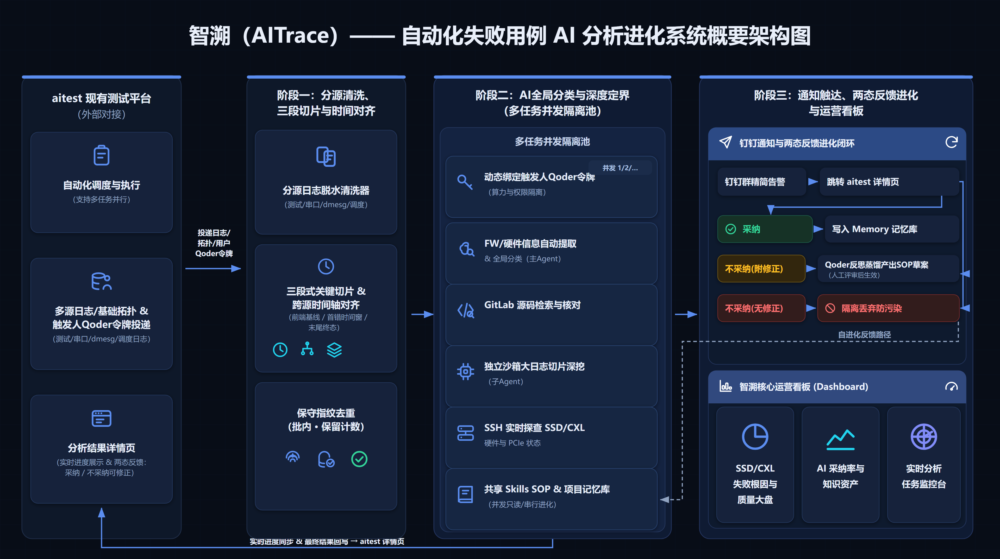

# 知因（AITrace）

> 自动化失败用例 AI 分析进化系统

AITrace 与现有自动化测试平台 **aitest** 形成协同矩阵：aitest 负责自动化任务调度与执行，知因负责失败用例的**智能追踪、根因定界与知识自进化**。业务聚焦 **SSD 与 CXL 硬件**自动化测试场景。

## 文档

| 文档 | 内容 |
|---|---|
| [docs/superpowers/specs/2026-11-25-aitrace-design-v1-final.md](docs/superpowers/specs/2026-11-25-aitrace-design-v1-final.md) | **V1.2 定稿（唯一有效方案）**：系统定位 · 双向接口契约 · 三阶段管线 · 并行调度 · 数据模型 · 安全与 SLO · Linux 进程部署 · 工程目录结构 · 评审记录 · Qoder CLI SDK 参考 |
| [docs/superpowers/specs/2026-11-22-aitrace-design-v1.md](docs/superpowers/specs/2026-11-22-aitrace-design-v1.md) | 历史存档（已被 2026-11-25 终稿取代，仅作追溯） |
| [docs/superpowers/plans/2026-11-25-aitrace-v1-program.md](docs/superpowers/plans/2026-11-25-aitrace-v1-program.md) | V1 总体实施计划（M0–M5 边界、接口、验证矩阵） |
| [docs/superpowers/plans/2026-11-25-aitrace-m0-foundation.md](docs/superpowers/plans/2026-11-25-aitrace-m0-foundation.md) | M0 契约冻结与骨架详细 TDD 计划 |
| [docs/superpowers/plans/2026-11-26-aitrace-m1-cleaning.md](docs/superpowers/plans/2026-11-26-aitrace-m1-cleaning.md) | M1 清洗流水线详细 TDD 计划（含执行记录） |
| [docs/superpowers/plans/2026-11-26-aitrace-m2-ai.md](docs/superpowers/plans/2026-11-26-aitrace-m2-ai.md) | M2 AI 分析链详细 TDD 计划（含执行记录与全部裁决） |

## 架构图

| 文件 | 规格 | 用途 |
|---|---|---|
| [architecture-v1.svg](architecture-v1.svg) | 1920 × 1090 矢量 | **概要图（深色主题）· 唯一可编辑图源** |
| [architecture-v1.png](architecture-v1.png) | 3840 × 2180（2× 渲染） | 文档内嵌与评审投屏 |
| [architecture-v1.html](architecture-v1.html) | 内嵌 SVG 的查看器 | 浏览器中直接打开浏览 |
| [architecture-v1-detail.svg](architecture-v1-detail.svg) | 1820 × 1164 矢量 | 详版：补充状态机、接口契约与安全红线 |
| [architecture-v1-detail.png](architecture-v1-detail.png) | 3640 × 2328（2× 渲染） | 详版位图 |
| [architecture-v1-detail.html](architecture-v1-detail.html) | 内嵌 SVG 的查看器 | 详版查看器 |
| [mermaid 原图](docs/superpowers/specs/2026-11-22-aitrace-design-v1-mermaid.png) | 1024 × 572 | 原始方案配图，仅作历史留档 |

## 核心架构原则

1. **系统独立解耦**——知因独立部署，与 aitest 通过标准双向 API 完成任务投递、进度同步、结果回写与人工反馈闭环，对测试执行引擎零侵入。
2. **高保真三段脱水 + AI 全权定界**——后端只做确定性加工（多源日志清洗、三段式切片、跨源时间轴对齐、保守指纹去重）；设备型号 / FW / 槽位等硬件信息以 aitest 权威下发为准，日志与只读探针仅作核对；根因分类与深度定界全权交由 Qoder AI。
3. **多任务并行与用户令牌隔离**——「谁启动任务、用谁的 Qoder 令牌分析」，一令牌一条串行队列、队列间轮转公平；执行隔离单元为 `task_id`（runtime / 凭证 / 探针 / 知识库均按任务隔离）。
4. **两态极简反馈闭环**——钉钉群只做轻量告警，证据核验与反馈交互全部收口 aitest 详情页；反馈仅【有效 / 无效（可附带修正）】两态。

## 流水线三阶段

| 阶段 | 职责 | 关键机制 |
|---|---|---|
| **阶段一** 分源日志清洗、三段切片与时间对齐 | 把几十至数百 MB 的四路原始日志提纯为高信噪比联合上下文 | 四源专用脱水策略 · 前端基线 / 首错时间窗（四路取最早）/ 末尾终态三段切片 · dmesg 与串口时间锚校准 · 保守指纹去重（批内 · 保留计数） |
| **阶段二** AI 全局分类与深度定界（Qoder SDK + 令牌级串行队列 + 共享 Worker 池） | 采用 aitest 权威硬件信息、归类根因、构建可回溯证据链 | 清洗与 AI 两级调度 · 每用户令牌队列串行 1 · 派发时 JIT 取令牌 · 主 Agent 批次全局统筹 · GitLab 源码核对 · 子 Agent 沙箱大日志深挖 · SSH 只读硬件探针 · Skills SOP 与 Memory 共享底座 |
| **阶段三** 通知触达、两态进化与运营看板 | 触达工程师并驱动知识自进化 | 钉钉精简告警 · VALID 写入案例库并刷新领域热记忆 · INVALID+修正蒸馏教训条目 · INVALID 无修正隔离丢弃 · 六大运营视图 |

## 安全红线

- **令牌安全**：`qoder_access_token` 全程 HTTPS 传输，仅在任务执行期间驻留内存，严禁写入数据库、任务队列、缓存或任何应用日志。
- **SDK 认证**：只允许内存 `accessToken(token)`；禁止 `accessTokenFromEnv()`、本地 CLI 登录态，任务 HOME 使用 tmpfs 且不持久化。
- **硬件探查安全**：SSH 实时探针严格受限于只读命令白名单，严禁写盘、`nvme format`、控制器 reset 或固件刷写等变更操作。

## 仓库状态

**M0 基础骨架 + M1 清洗流水线 + M2 AI 分析链已实现并验证**（2026-11-27）：M0 契约冻结、数据模型与审计链、队列/租约/令牌槽门、投递与查询 API、aitest mock（含控制台前端）；M1 四源脱水插件、首错定位、跨源对齐与锚点级联、三段切片、双层指纹、L1 证据落盘、截流五规则、清洗 Worker、聚合闸；M2 每令牌串行队列与 JIT 令牌（一令牌=一账号=一条队列、无兜底、仅内存持有）、Qoder 主/子代理编排（国内 SDK qodercn_agent_sdk，VPC 网关 `vpc_endpoint` + 精确大小写模型名 `GLM-5.3-Flash` 装配）、七维置信度评分、截流/暂停/恢复/放弃生命周期、PROGRESS/RESULT/QUEUE_STATE 回调通道（含 JSON Schema 契约）、批次关账、后台调度循环（daemon 线程七段 tick）、迁移 0003-0005。验证结果（2026-11-27 fresh）：`make verify` 全绿（`make lint` 清洁 · `make test` 243 passed · `make contract` 20 passed · `make e2e` 4 passed）；端到端系统级验证（真实 HTTP mock↔AITrace）：**cn 真实模型正向全链 COMPLETED**（真实 CN PAT + twsc VPC 专线 + GLM-5.3-Flash + 双子代理 → 批次 COMPLETED、RESULT 回调、状态 API 完整报告，OTHER 硬顶置信度 0.5 生效），Fake 版正向全链 COMPLETED + RESULT 回调 + 状态 API 完整报告，真实 SDK 负向全链 FAILED 正确传播（stage=FAILED「一键重新触发」）；aitest mock 控制台（用例清单/推送/会话轮询/解析结果详情/运营看板/回调记录）Playwright 浏览器实测全通。修复轮收敛 3 个状态语义缺陷 + CN 网关三要素 + 看板乱序聚合（详见 M2 计划文末「端到端验证记录」）。M3–M5（反馈闭环、SLO 运维、加固）按总体计划继续实施。实现期目录按终稿 §10.3 组织：`src/aitrace`（生产代码）· `contracts`（双向契约）· `mocks/aitest`（独立 aitest mock）· `deploy`（部署与配置）· `data`（运行数据）· `tests`（分层测试）。生产环境为 **Linux + systemd 进程部署（无容器）**：单主进程、本机 PostgreSQL、TLS 反向代理、随 release 锁定的 Qoder CLI runtime，发布与回滚按 §8.5 执行。
