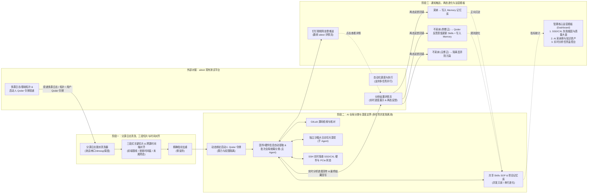

# 智溯（AITrace）—— 自动化失败用例 AI 分析进化系统架构方案

> 版本：V1（2026-11-22 新方案，V0 初稿架构已清空重设计）
> 配套全景架构图：[`architecture-v1.png`](../../../architecture-v1.png)

---

## 1. 系统定位与核心设计原则

**系统名称**：智溯（AITrace），与现有自动化测试平台 aitest 形成协同矩阵——aitest 负责自动化任务调度与执行，AITrace 负责失败用例的智能追踪、根因定界与知识自进化。

**业务覆盖范围**：聚焦 SSD 与 CXL 硬件自动化测试场景。

### 核心架构原则

1. **系统独立解耦**：智溯作为独立服务部署，与 aitest 平台通过标准双向 API 完成任务投递、实时进度同步、定界结果回写与人工反馈闭环，对测试执行引擎零侵入。
2. **高保真三段脱水与 AI 全权定界**：后端专注多源日志清洗、前端 / 首错 / 末尾三段式关键切片、跨源时间轴对齐与 100% 确定性精确去重；固件版本提取、根因分类与深度定界全权交由 Qoder AI 结合源码与硬件现场统筹完成。
3. **多任务并行与用户令牌隔离**：遵循"谁启动任务、用谁的 Qoder 令牌分析"原则，支持多批次并发隔离执行，实现算力配额归属清晰、GitLab 代码权限零越权、任务沙箱互不串台。
4. **两态极简反馈闭环进化**：钉钉群负责轻量化告警触达，所有证据核验与反馈交互收口至 aitest 详情页；通过【采纳 / 不采纳（可附带修正）】两态交互驱动知识沉淀、方法论升级与噪音隔离。

---

## 2. 系统全景架构与数据流向



**全景架构图**：[`architecture-v1.png`](../../../architecture-v1.png)

---

## 3. 外部对接域：aitest 平台双向接口契约

### 3.1 去向接口：任务与多源数据投递（aitest → 智溯）

自动化测试批次结束或出现失败用例时，aitest 调用 `POST /api/v1/aitrace/tasks` 投递分析请求。鉴于 aitest 平台不维护被测盘的 FW 版本等底层硬件明细，接口仅传递基础环境拓扑与日志句柄，具体固件版本与设备属性由 AI 在分析阶段从日志及硬件探针中自主提取。

```json
{
  "batch_id": "BATCH-20261120-0089",
  "trigger_user_id": "zhangsan",
  "qoder_access_token": "<ENCRYPTED_USER_TOKEN>",
  "hardware_type": "SSD",
  "env_topology": {
    "host_ip": "10.12.8.45",
    "host_boot_time_utc": 1795104000,
    "pcie_bdf": "0000:3b:00.0",
    "device_node": "/dev/nvme0n1"
  },
  "git_context": {
    "repo_url": "https://gitlab.internal/ssd-qa/nvme-auto.git",
    "commit_id": "a9c4e12f"
  },
  "failed_cases": [
    {
      "case_id": "CASE-1021",
      "script_path": "tests/stress/test_io_reset.py::test_hot_reset",
      "logs": {
        "test_log_url": "s3://aitest-logs/.../pytest.log",
        "uart_log_url": "s3://aitest-logs/.../uart.log",
        "kernel_log_url": "s3://aitest-logs/.../dmesg.log",
        "scheduler_log_url": "s3://aitest-logs/.../scheduler.log"
      }
    }
  ]
}
```

### 3.2 回向接口：实时进度同步与结果回写（智溯 → aitest）

智溯在分析全周期的各关键节点主动回调 `POST /api/v1/aitest/aitrace/status` 推送实时进度，完成后回写结构化定界报告（包含 AI 自动提取的被测硬件型号与 FW 版本、根因归类、置信度、多源联合证据切片及排查建议）。

| 状态标识 (stage) | 进度 | aitest 页面展示文案 | 说明 |
|---|---|---|---|
| `QUEUED` | 10% | 排队等待分析中... | 智溯已接收批次并进入并发任务队列 |
| `CLEANING` | 30% | 正在进行多源日志脱水、三段切片与时间对齐... | 分源清洗器、三段式切片与时间锚点对齐执行中 |
| `AI_CLASSIFYING` | 50% | Qoder 主引擎正在提取硬件信息并全局归类... | 主 Agent 提取 FW / 设备信息并划分故障簇 |
| `DEEP_PROBING` | 75% | 正在检索源码、深挖大日志并实查 SSD/CXL 状态... | 子 Agent 介入大日志检索与 SSH 只读探查 |
| `COMPLETED` | 100% | 智溯分析完成（点击查看根因报告） | 定界结论与证据切片已回写，同步触发钉钉告警 |
| `FAILED` | - | 分析异常（支持一键重新触发） | 令牌失效或网络超时等异常，保留手动重试入口 |

### 3.3 两态反馈回调接口（aitest → 智溯）

工程师在 aitest 分析结果详情页完成评审后，前端调用 `POST /api/v1/aitrace/feedback` 回传两态操作（`ADOPT` 或 `REJECT`）；当选择 `REJECT` 时，支持在弹窗中附带可选的 `correction` 修正信息：

```json
{
  "batch_id": "BATCH-20261120-0089",
  "case_id": "CASE-1021",
  "reviewer": "zhangsan",
  "action": "REJECT",
  "correction": {
    "root_cause_category": "TEST_ENV_ERROR",
    "reason": "该报错实为测试机 PCIe 转接卡接触不良导致掉盘，非 SSD 固件死锁"
  }
}
```

---

## 4. 阶段一：分源日志清洗、三段切片与时间对齐引擎

阶段一采用插件化分源策略（Strategy Pattern），核心目标是**高保真脱水**——将动辄几十至数百 MB 的四路原始日志提纯为结构清晰的高信噪比联合上下文，确保初始设备信息、第一报错现场与最终收尾状态均无遗漏。

### 4.1 四源专用脱水清洗策略

| 日志类型 | 典型噪声特征 | 核心清洗动作 | 必须保留的关键信息 |
|---|---|---|---|
| **1. 测试执行日志**（pytest / fio） | 进度条刷新、每秒正常 IOPS / 带宽轮询刷屏、重复正常步骤输出 | ① 剥离 ANSI 颜色码与 `\r` 控制符；② 正常性能采样按 60 秒降频留基线，异常窗口全量保留；③ 完整保留 Traceback 与退出码 | 初始化打印的盘符 / 设备识别 / FW 版本信息、用例入参、fio / 压测配置、首错与收尾调用栈 |
| **2. 串口日志**（UART） | 断电 / 波特率切换产生的乱码字节、高频后台 GC 或温度心跳、仅带固件内部 Tick | ① 清洗不可见二进制乱码；② 折叠周期性正常心跳与后台状态轮询；③ 提取固件内部 Tick 供时间锚定 | 启动阶段固件版本 / Build ID 打印；所有含 `ASSERT / PANIC / FATAL / ERR / ABORT / TIMEOUT / WATCHDOG / RESET` 的行及其前后各 30 行寄存器现场 |
| **3. 系统内核日志**（dmesg / messages） | 大量无关 OS 服务日志（systemd / cron / SSH 审计）、单条 I/O 报错刷屏数万行 | ① 按硬件子系统白名单过滤（nvme、pcieport、aer、cxl、edac、mce、oom_reaper、blk_update_request、kernel: BUG）；② 连续重复报错做模板折叠，输出起止时间与重复次数 | 设备枚举与驱动加载信息、PCIe 链路降速 / 断开（Link Down / AER）、NVMe Controller Reset、CXL 协议异常、内核 Call Trace |
| **4. 平台调度日志**（aitest 调度器） | 队列等待轮询、心跳上报流水账 | ① 压缩正常状态机流转记录为单行摘要；② 抽取环境初始化、锁板与结束退出节点 | 环境前置准备参数、调度超时、锁板冲突、Agent 失联与任务终止原因 |

### 4.2 三段式精准切片与跨源时间轴对齐（Timeline Merger）

为了避免只截单一片段导致"丢失设备版本基线"或"被级联报错掩盖真正诱因"，清洗引擎对每路日志执行三段式切片 + 跨源时间轴对齐。

**三段式精准切片策略**

- **前端基线切片（日志头部）**：截取各路日志起始段（前 100~200 行清洗后精华），完整保留测试启动参数、环境初始化状态、设备枚举记录及串口启动打印，确保 AI 能够直接提取被测 SSD / CXL 型号、SN、FW 版本及测试配置基线。
- **失败点首错窗切片（First-Error Window）**：优先扫描并锁定首次触发异常语义或非零错误码的"第一报错现场"（避免直接落入后半段成千上万条级联雪崩报错中），以该首错时间戳为锚点，在四路日志中同步双向截取前 60 秒至后 15 秒的完整上下文。
- **末尾收尾切片（日志尾部）**：截取各路日志末尾段（最后 100~200 行清洗后精华），完整保留最终异常抛出堆栈、进程退出码、Teardown 清理结果、设备掉线终态以及串口最后打印的死锁 / 复位信息。

**跨源绝对时间轴校准**

- 测试日志与调度日志直接解析标准 UTC / Unix 毫秒时间戳；
- dmesg 开机相对秒数结合 aitest 传入的 `host_boot_time_utc` 换算为绝对物理时间；
- 无外部时钟的串口日志通过特征事件互锁锚点（例如测试日志下发 Admin / Format 命令的时间与串口收到对应指令的 Tick 点）计算偏移量并对齐至同一时间轴，最终拼装为结构化的《多源三段式联合诊断摘要》。

### 4.3 精确指纹去重（零误杀）

仅对**同时满足**「测试脚本路径与行号一致 + 异常类型与错误码一致 + 硬件类型与测试机拓扑特征一致」的 100% 相同刷屏报错做精确合并，确保任何可能指向不同底层根因的样本均完整送入 AI 分析层。

---

## 5. 阶段二：AI 全局分类与深度定界（Qoder SDK + 多任务并发隔离池）

### 5.1 多任务并发隔离池（Per-Batch Isolation）

面对实验室多批次并发触发的峰值场景，通过异步任务调度池（支持全局并发上限与单用户并发限流）为每个 `batch_id` 建立四重严格隔离执行单元：

1. **凭证与权限隔离**：每个并发 Worker 仅在内存中动态注入当前批次启动人的 `qoder_access_token`，调用 Qoder SDK 时天然继承该用户的算力配额与代码库读取权限；任务结束立即销毁内存凭证句柄。
2. **独立日志沙箱隔离**：当前批次的四路原始大日志与三段切片挂载至独占临时路径 `/tmp/aitrace_workspace/{batch_id}/`，子 Agent 的大日志检索工具严格锁定在当前沙箱目录内，任务归档后按 TTL 自动清理。
3. **SSH 只读探针隔离**：探查 Linux 测试机时建立独立只读 SSH 会话并执行命令白名单；当多批次同时探查同一台测试机时，通过设备级轻锁与短时快照缓存防止并发命令干扰被测盘。
4. **知识库读写分离**：并发分析期间，所有 Worker 并发只读共享的 Skills SOP 与 Memory；反馈触发知识进化写入时，统一进入串行更新队列并加锁提交，防止并发写冲突。

### 5.2 Qoder 主从协同推理与多维证据链

在每个隔离执行单元内，基于 Qoder SDK 编排完整推理闭环，所有定界结论均附带可回溯证据链：

- **固件 / 硬件元数据自动提取**：Qoder 首先从清洗后的前端基线切片（测试日志初始化输出、串口固件头、内核枚举信息）中自动解析提取被测 SSD / CXL 的具体型号、SN、固件版本（FW Version）等结构化属性；若日志中未打印，则通过 SSH 只读探针实时读取补全，并将提取结果回写至诊断报告与运营看板。
- **批次全局统筹分类（主 Agent）**：摄入本批次所有去重后的【三段式多源诊断摘要 + 环境拓扑 + 提取的固件 / 硬件信息】，横向比对同主机、同槽位、同固件版本的表现，自主按真实根因归类（精准区分：测试环境异常 / 测试脚本问题 / SSD 固件或硬件缺陷 / CXL 硬件或协议缺陷）。
- **GitLab 源码检索与核对**：依托动态绑定的启动人 Qoder 令牌，拉取对应 `commit_id` 的测试脚本或驱动源码片段，核对命令序列、超时间隔与断言条件，准确区分脚本预期偏差与硬件真实违例。
- **独立沙箱大日志切片深挖（子 Agent）**：当三段式摘要仍不足以锁定复杂长稳故障（如性能缓慢跌落、偶发隐蔽死锁）时，主 Agent 派发子 Agent 调用大日志检索工具对原始大日志执行按需关键字或任意时间段二次深挖。
- **SSH 实时探查环境与硬件状态（MCP 只读探针）**：实时登录对应 Linux 测试机获取现场铁证——包括 SSD 盘端状态（`nvme list`、`nvme id-ctrl`、`nvme smart-log`、`nvme error-log`）、CXL 设备与拓扑状态（`cxl list`、链路与解码器状态）、PCIe 链路健康度（`lspci -vvv` 速率 / 位宽 / AER 计数）及宿主机基础资源（磁盘空间 / 残留进程）。
- **共享领域知识底座（Skills SOP & Memory）**：按 `hardware_type`（SSD / CXL）动态加载对应领域排障手册（`.qoder/skills/`）与历史高置信度已采纳记忆，优先复用已验证的团队排障经验。

---

## 6. 阶段三：通知触达、两态反馈进化与核心运营看板

### 6.1 钉钉群通知与 aitest 详情页联动

- **钉钉群精简告警**：批次分析完成并回写 aitest 后，推送精简卡片至项目钉钉群，展示批次号、涉及硬件与 AI 提取的 FW 版本、根因分类摘要与高危标记，并附带直达 aitest 分析结果详情页的跳转链接。
- **aitest 详情页交互**：工程师点击进入详情页，可一站式查看 AI 提取的硬件 / FW 信息、根因归类、置信度评分、前端 / 首错 / 末尾三段跨源日志证据链、GitLab 代码核对依据及 SSH 硬件实查快照，并在页面内直接点击【采纳】或【不采纳】（点不采纳时弹出轻量化修正表单，支持选填正确根因）。

### 6.2 两态人工反馈驱动的自进化闭环

| aitest 详情页操作 | 回调载荷特征 | 智溯后端触发动作 | 系统进化效果 |
|---|---|---|---|
| ✅ **采纳** | `action: "ADOPT"` | 将"多源异常指纹 + 硬件 / FW 与环境特征 + 定界结论"标记为 Verified，串行写入项目级 Memory 记忆库 | 沉淀为高置信度团队资产，后续再遇同类特征实现秒级精准命中 |
| ❌ **不采纳（附带修正根因）** | `action: "REJECT"`，`correction != null` | 计入"不采纳"统计，同时唤醒 Qoder 后台反思蒸馏任务：比对三段式日志证据、AI 错误推理链路与人工正确结论，自动提炼避坑排查规则并更新 `.qoder/skills/` SOP，同时将正确结论写入 Memory | 不仅记录单点案例，更升级底层排查方法论，防止同类误判复发 |
| ❌ **不采纳（未填修正）** | `action: "REJECT"`，`correction == null` | 严格隔离丢弃：仅记入看板统计，不写入 Memory，也不更新 Skills | 彻底隔离偶发毛刺与低质量数据，防止污染知识库 |

### 6.3 智溯核心运营看板（Dashboard）

看板围绕 3 大核心视图构建，全面呈现 SSD / CXL 质量态势、AI 进化成效与实时运行状态：

**① 失败根因分布与质量大盘（聚焦 SSD / CXL）**

- 周期内归因占比分布（环境异常 vs 脚本问题 vs SSD 缺陷 vs CXL 缺陷）；
- 基于 AI 自动提取的硬件型号与固件版本（FW Version）统计不同版本的失败率演变趋势；
- Top 10 高频故障模式排行，助力团队集中攻克共性瓶颈。

**② AI 采纳率与知识资产**

- 核心效能趋势曲线：AI 一次采纳率演变轨迹及有效修正贡献统计（直观验证系统是否越用越准）；
- 提效量化指标：累计分析用例数、多源大日志脱水压缩比、平均单批次定界耗时；
- 知识资产沉淀规模：已验证 Memory 案例总量与自进化 Skills 规则条目数。

**③ 实时分析任务监控台**

- 实时流水线任务队列状态监控（排队中 / 清洗切片中 / AI 深度分析中 / 已完成待反馈）；
- 高危异常滚动告警栏（置顶展示最新定界为 FW ASSERT、AER Fatal、CXL Link Down 等严重硬件缺陷的批次，支持一键直跳 aitest 详情页）。

---

## 7. 安全与合规规范

- **令牌安全红线**：`qoder_access_token` 全程采用 HTTPS 加密传输，仅在对应并发任务执行期间驻留内存，严禁写入数据库、Redis 持久化文件或任何应用日志；若任务排队期间令牌失效，状态机置为 `FAILED` 并通知 aitest 引导触发人重新授权重试。
- **硬件探查安全红线**：SSH 实时探针严格受限于只读命令白名单，严禁在分析过程中对被测 SSD / CXL 设备执行写盘、格式化（`nvme format`）、控制器重置（reset）或固件刷写等任何变更或破坏性操作。

---

## 附录 A · 全景架构图


图源：[`architecture-v1.png`](../../../architecture-v1.png)（1024 × 572 PNG）

## 附录 B · 关键名词对照

| 名词 | 含义 |
|---|---|
| 三段式切片 | 前端基线（头部）+ 首错时间窗（失败点）+ 末尾终态（尾部），对每路日志执行的确定性抽取 |
| 首错时间窗 | 以首次触发异常语义或非零错误码的现场为锚，向前 60 秒、向后 15 秒的联合上下文 |
| 精确指纹去重 | 脚本路径行号 + 异常类型错误码 + 硬件类型与拓扑特征三者全同才合并，零误杀 |
| 多任务并发隔离池 | 以 `batch_id` 为单元的四重隔离执行池（凭证、沙箱、探针、知识库） |
| 两态反馈 | 采纳（ADOPT）/ 不采纳（REJECT），后者可选附带 correction |
| Skills SOP | `.qoder/skills/` 下的领域排障手册，由人工修正驱动的反思蒸馏更新 |
| Memory 记忆库 | 项目级已采纳案例记忆库，并发只读、串行写入 |
