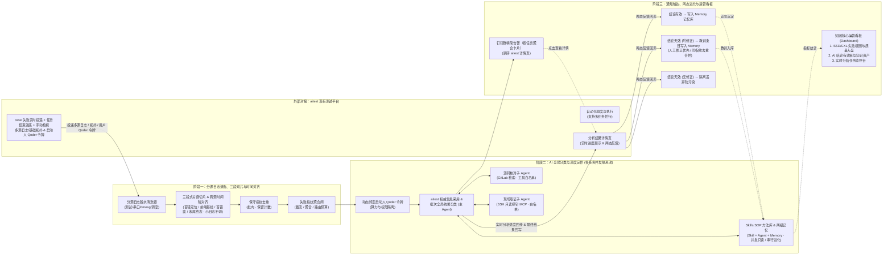
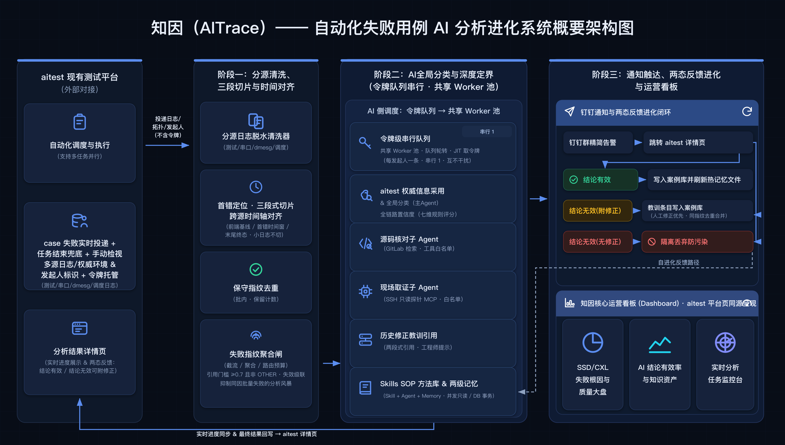

# 知因（AITrace）—— 自动化失败用例 AI 分析进化系统架构方案

> **已被取代（2026-11-25）**：本文档为历史存档，不再维护。唯一有效方案见 [`2026-11-25-aitrace-design-v1-final.md`](2026-11-25-aitrace-design-v1-final.md)（V1.0 定稿，已合并且已评审冻结）。本文档仅用于追溯旧决策，若与终稿冲突以终稿为准。

> 版本：V1（2026-11-22 新方案，V0 初稿架构已清空重设计）
> 配套概要架构图：[`architecture-v1.svg`](../../../architecture-v1.svg) · [`architecture-v1.png`](../../../architecture-v1.png) · [`architecture-v1.html`](../../../architecture-v1.html)（矢量源 / 位图 / 在线查看器）

---

## 1. 系统定位与核心设计原则

**系统名称**：知因（AITrace），与现有自动化测试平台 aitest 形成协同矩阵——aitest 负责自动化任务调度与执行，AITrace 负责失败用例的智能追踪、根因定界与知识自进化。

**业务覆盖范围**：聚焦 SSD 与 CXL 硬件自动化测试场景。

### 核心架构原则

1. **系统独立解耦**：知因作为独立服务部署，与 aitest 平台通过标准双向 API 完成任务投递、实时进度同步、定界结果回写与人工反馈闭环，对测试执行引擎零侵入。
2. **高保真三段脱水与 AI 全权定界**：后端专注多源日志清洗、首错定位、前端 / 首错 / 末尾三段式关键切片（大小感知 · 边界兜底）、跨源时间轴对齐与确定性保守去重（批内 · 保留计数）；aitest 权威信息采用（设备明细不再从日志提取）、根因分类与深度定界全权交由 Qoder AI 结合源码与硬件现场统筹完成。
3. **多任务并行与用户令牌隔离**：遵循"谁启动任务、用谁的 Qoder 令牌分析"原则，支持多批次并发隔离执行，实现算力配额归属清晰、GitLab 代码权限零越权、任务执行单元互不串台；任务创建人未托管令牌时，自动触发改用必配的平台级兜底令牌并标注启动人，兜底令牌缺失则投递报错拒收（§3.1）。
4. **两态极简反馈闭环进化**：钉钉群负责轻量化告警触达，所有证据核验与反馈交互收口至 aitest 详情页；通过【结论有效 / 结论无效（可附带修正）】两态交互驱动知识沉淀与噪音隔离。
5. **case 级实时触发与同因聚合**：单 case 失败即实时投递分析（时效与失败现场优先），任务结束兜底收口；阶段一聚合闸（截流 / 聚合 / 路由预算）抑制同因批量失败的分析风暴，钉钉告警按任务聚合卡片，分析与通知均不随失败 case 数线性放大。

---

## 2. 系统全景架构与数据流向



**概要架构图**：[`architecture-v1.svg`](../../../architecture-v1.svg) · [`architecture-v1.png`](../../../architecture-v1.png) · [`architecture-v1.html`](../../../architecture-v1.html)（详版见附录 A）

---

## 3. 外部对接域：aitest 平台双向接口契约

### 3.1 去向接口：任务与多源数据投递（aitest → 知因）

**触发时机：单 case 失败实时触发为主，任务结束兜底为辅**——aitest 各用例日志为独立文件，任一 case 失败即以该 case 为粒度立即调用 `POST /api/v1/aitrace/tasks` 投递分析（时效性与失败现场新鲜度优先，见 §5.2 探针时效判定）；任务整体结束时再做一次兜底投递，覆盖实时回调漏投并支持批内全局统筹。投递时日志可能仍在追加写，按 `failed_at_utc` 做快照式逻辑截断读取。同因批量失败的分析风暴由阶段一聚合闸抑制（§4.6），告警通知按任务聚合（§6.1），均不随失败 case 数线性放大。**信息权威性约定**：日志信息、环境信息（设备资产：型号 / SN / FW / 槽位映射）与任务详情中失败 case ↔ 环境的一一对应，均由 aitest 侧维护并保证准确，随投递载荷下发；知因直接采用 aitest 提供的权威信息，**不再从日志自行提取硬件明细**（日志仅作证据核对），SSH 探针只做现场取证与一致性核验（§5.2 / §5.3）。接口以 `product_id` 声明所属产品线，知因据此匹配所属领域画像（§8）；缺失或未匹配时按默认画像处理。

**aitest 侧触发实现（AI 检视触发模块）**：aitest 后端内置一个对内的触发模块，两个入口共用同一出口——① 自动入口：执行引擎在用例结束收口处判定失败，即以该 case 为粒度触发；② 手动入口：aitest 前端失败列表提供「AI 检视」按钮，工程师可对任意未分析 case 手动触发。触发模块只组装轻量元数据（batch_id / case_id / failed_at_utc / 日志路径），经独立线程异步投递，发送失败落本地待发队列按退避重试，不阻塞用例串行执行。幂等键为 `(product_id, batch_id, case_id)`：实时触发、任务结束兜底与手动触发可能重复命中同一 case，知因按该键去重，已存在会话时直接返回既有会话、不重复分析。兜底投递即使全部 case 会话已存在，仍会更新批次上下文（全量失败 / 通过清单、批总量）并触发批级共因评估（§4.6）——去重只跳过逐 case 重分析，不丢弃批级聚合数据。兜底两重：任务结束执行引擎把全量失败清单再触发一次；知因周期性调用 aitest 用例状态清单接口对账查漏（§3.4），对账发现漏投 case 时按清单直接补建会话并进入正常管线（标注来源「对账补投」），不等待 aitest 补投。

**令牌传输链路（前端 storage → aitest 后端 → 知因）**：前端永不直连知因，`qoder_access_token` 只出现在「aitest 后端 → 知因」的 HTTPS 服务间链路。用户在 aitest 前端完成授权时，令牌经 `POST /api/v1/aitest/token` 提交给 aitest 后端**加密托管**（AES-256 落库、密钥托管、访问审计），前端 storage 仅保留授权标记与短期会话，不长期持有令牌本体——投递主要由后端执行引擎发起，后端拿不到前端 storage。投递时由 aitest 后端按 `trigger_user_id` 从托管库取出令牌注入请求；自动触发（执行引擎）取**任务创建人**的托管令牌，创建人未授权时改用平台级兜底令牌（§9.1 **必配项**），报告标注「平台自动（任务创建人 xxx）」；兜底令牌未配置时投递直接报错拒收（返回 `TOKEN_REQUIRED`），不静默兜底，aitest 据此提示任务创建人授权后重试；手动触发（前端「AI 检视」按钮）经 aitest 后端中转，同样由后端注入托管令牌，前端请求体不携带令牌。托管库归属 aitest 侧，与知因「令牌仅内存驻留、严禁落库」红线（§7）互不冲突；知因侧令牌失效时按 §3.2 回写 `FAILED`，aitest 据此提示触发人重新授权。

```json
{
  "product_id": "ssd_9560",
  "batch_id": "BATCH-20261120-0089",
  "trigger_user_id": "zhangsan",
  "qoder_access_token": "<用户令牌 · 服务间 HTTPS 明文传输 · 知因侧仅内存驻留>",
  "hardware_type": "SSD",
  "env_topology": {
    "host_ip": "10.12.8.45",
    "host_boot_time_utc": 1795104000,
    "devices": [
      {
        "device_id": "D1",
        "pcie_bdf": "0000:3b:00.0",
        "device_node": "/dev/nvme0n1",
        "model": "AliFlash V6 3.84T",
        "sn": "SN-20240315-XXXX",
        "fw_version": "8.1.2.3",
        "slot": "SLOT-3"
      }
    ]
  },
  "git_context": {
    "repo_url": "https://gitlab.internal/ssd-qa/nvme-auto.git",
    "commit_id": "a9c4e12f"
  },
  "failed_cases": [
    {
      "case_id": "CASE-1021",
      "script_path": "tests/stress/test_io_reset.py::test_hot_reset",
      "failed_at_utc": 1795105200,
      "env_binding": { "device_id": "D1" },
      "logs": {
        "test_log_path": "/logs/BATCH-20261120-0089/CASE-1021/pytest.log",
        "uart_log_path": "/logs/BATCH-20261120-0089/CASE-1021/uart.log",
        "kernel_log_path": "/logs/BATCH-20261120-0089/CASE-1021/dmesg.log",
        "scheduler_log_path": "/logs/BATCH-20261120-0089/CASE-1021/scheduler.log"
      }
    }
  ],
  "passed_cases": [
    { "case_id": "CASE-0987", "script_path": "tests/stress/test_io_reset.py::test_cold_reset" }
  ]
}
```

`failed_at_utc`（用例失败时刻）用于首错窗口校验与 SSH 探针时效判定；`hardware_type` 声明被测硬件类型（SSD / CXL），供画像装配校验与看板维度统计（§6.3 ③）；`env_topology.devices[]` 为 aitest 维护的设备资产权威信息（型号 / SN / FW / 槽位 / 节点映射），每个失败 case 经 `env_binding.device_id` 与环境一一对应——aitest 保证该映射准确，知因直接采用、不再从日志提取（§5.2）。`passed_cases` 为可选字段——同批次通过用例清单，供主 Agent 横向对照（同主机 / 同固件下通过与失败的对照），缺失时对照退化为仅用历史 Memory。实时触发时 `failed_cases` 通常仅含当前失败 case，`passed_cases` 为截至失败时刻同批已结束的通过用例；任务结束兜底投递携带全量失败 / 通过清单，供批内全局统筹与批级共因分析（§4.6 / §5.2）。`logs` 为 aitest 日志接口路径句柄而非文件内容——GB 级日志只拉不推，知因按需经 `GET /api/v1/aitest/logs?path=` 拉取（§3.4）。

### 3.2 回向接口：实时进度同步与结果回写（知因 → aitest）

知因在分析全周期的各关键节点主动回调 `POST /api/v1/aitest/aitrace/status` 推送实时进度，完成后回写结构化定界报告（包含 aitest 权威提供的被测硬件型号与 FW 版本〔经探针核验〕、根因归类、全链路置信度与分项分解、多源联合证据切片及排查建议）。

| 状态标识 (stage) | 进度 | aitest 页面展示文案 | 说明 |
|---|---|---|---|
| `QUEUED` | 10% | 排队等待分析中... | 知因已接收批次并进入并发任务队列 |
| `CLEANING` | 30% | 正在进行多源日志脱水、首错定位、三段切片与时间对齐... | 分源清洗器、首错定位、三段式切片与时间锚点对齐执行中 |
| `AI_CLASSIFYING` | 50% | Qoder 主引擎正在全局归类并定界... | 主 Agent 采用 aitest 权威环境信息并划分故障簇 |
| `DEEP_PROBING` | 75% | 正在检索源码并实查 SSD/CXL 状态... | 子 Agent 介入 GitLab 源码核对与 SSH 只读探查 |
| `COMPLETED` | 100% | 知因分析完成（点击查看根因报告） | 定界结论与证据切片已回写，同步触发钉钉告警 |
| `FAILED` | - | 分析异常（支持一键重新触发） | 令牌失效或网络超时等异常，保留手动重试入口 |

状态回调载荷携带 `round` 字段标注当前诊断轮次；重诊产生的过程明细按轮次独立上报（会话轮次模型见 §10）。实时触发时状态与报告按 case（会话）粒度回写，任务结束兜底投递按批汇总回写。

### 3.3 两态反馈回调接口（aitest → 知因）

工程师在 aitest 分析结果详情页完成评审后，前端经 aitest 后端中转调用 `POST /api/v1/aitrace/feedback` 回传两态操作（`VALID` 或 `INVALID`）；当选择 `INVALID` 时，支持在弹窗中附带可选的 `correction` 修正信息。`round` 字段绑定评价目标轮次，缺省视为最新轮次（会话轮次模型见 §10）：

```json
{
  "session_id": "S-20261123-0889",
  "batch_id": "BATCH-20261120-0089",
  "case_id": "CASE-1021",
  "round": 1,
  "reviewer": "zhangsan",
  "action": "INVALID",
  "correction": {
    "root_cause_category": "TEST_ENV_ERROR",
    "reason": "该报错实为测试机 PCIe 转接卡接触不良导致掉盘，非 SSD 固件死锁"
  }
}
```

`session_id` 为主定位键（`batch_id / case_id` 冗余携带用于校验）；`root_cause_category` 取闭集枚举：`TEST_ENV_ERROR` / `FW_DEFECT` / `SCRIPT_ISSUE` / `HW_DEFECT` / `OTHER`，与 §5.2 五类根因一一对应；`reason` 即修正说明文本（自由填写），同时作为重诊线索注入新轮次（§10.4）。

### 3.4 平台双向接口清单（职责划分）

划分原则：**数据 / 能力在哪边，接口就在哪边实现；动作发起方决定谁调谁**。aitest 持有执行域（用例、日志、**权威环境信息与设备资产映射**，§3.1），知因持有诊断域（分析、报告、看板、记忆）。SSH 探针不走 aitest 通道——知因直连测试主机执行只读命令（§5.2 白名单，主机凭据由知因自管）。

| 接口 | 调用时机（方向） | 实现方 |
|---|---|---|
| `POST /api/v1/aitrace/tasks` 投递诊断任务 | aitest AI 检视触发模块调用（case 失败实时 / 任务结束兜底 / 手动检视）；响应含 `session_id` 与 `is_existing`（幂等去重命中时 `is_existing: true`，直接返回既有会话不重复分析） | 知因 |
| `GET /api/v1/aitrace/tasks/{id}` 状态与报告查询 | aitest 前端展示进度 / 结论；`{id}` 即会话 `session_id`（任务与会话一一对应，§10.1） | 知因 |
| `POST /api/v1/aitrace/feedback` 评价回写 | 工程师在 aitest 详情页评价（§3.3） | 知因 |
| `POST /api/v1/aitrace/sessions/{session_id}/rediagnose` 重诊 | 工程师点重诊（含附件上传，§10.4 / §10.6） | 知因 |
| `POST /api/v1/aitrace/sessions/{session_id}/attachments` 附件上传 | 工程师上传日志 / 图片补充证据（§10.6） | 知因 |
| `GET /api/v1/aitrace/dashboard/summary` 看板聚合数据 | aitest 前端平台页看板拉取（§6.3 双端呈现；只拉不推，按 `product_id` 权限过滤） | 知因 |
| `POST /api/v1/aitest/aitrace/status` 进度与结果回写 | 知因分析各节点回调（§3.2） | aitest |
| `GET /api/v1/aitest/logs?path=&failed_at_utc=` 日志流式下载 | 知因组装证据前拉取（GB 级只拉不推；支持 `Range` 分段 / 断点续传；可选 `failed_at_utc` 按失败时刻逻辑截断，避免追加写污染首错窗，§3.5） | aitest |
| `GET /api/v1/aitest/logs?batch_id=&case_id=` 相关日志清单 | 知因核对投递载荷完整性 / 重诊补拉缺失源（§3.5） | aitest |
| `GET /api/v1/aitest/tasks/{batch_id}` 任务环境信息 | 知因对账核验设备映射与补全批次上下文（拓扑 / 设备-槽位映射 / 启动日志；载荷缺失时兜底） | aitest |
| `GET /api/v1/aitest/cases?batch_id=` 用例状态清单 | 知因对账查漏（兜底） | aitest |
| `GET /api/v1/aitest/notify-config?product_id=` 分产品通知配置 | 知因任务受理时拉取钉钉群（webhook / @人 / 可选高危独立群）并缓存（§6.1 ⑥） | aitest |
| `POST /api/v1/aitest/token` 用户令牌托管（对内） | aitest 前端授权时提交 Qoder 令牌 → 后端加密落库；投递时后端按 trigger_user_id 注入（§3.1 令牌传输链路） | aitest |
| AI 检视触发模块（aitest 对内接口） | 前端「AI 检视」按钮 / 执行引擎失败收口调用，出口统一转调知因投递接口（§3.1） | aitest |

关键约定：

- **前端永不直连知因**：所有 aitest → 知因请求（投递 / 查询 / 评价 / 附件 / 重诊）一律由 aitest 后端中转并注入服务令牌，前端只调用 aitest 后端（呼应 §3.1 令牌传输链路）；
- **大日志只拉不推**：投递请求只带元数据 + 日志路径，知因拿到路径后按需经日志下载接口拉取（`Range` 分段下载，§3.5），HTTP 不承载 GB 级文件；
- **推送为主、拉取兜底**：失败事件由 aitest 推送（时效与失败现场新鲜度优先）；漏投靠任务结束兜底投递 + 用例状态清单对账补漏，轮询不承担主通道；
- **双向认证最小权限**：aitest → 知因持服务令牌（投递 / 评价 / 查询），知因 → aitest 持日志读取 / 查询令牌，互不混用；
- **幂等**：投递按 `(product_id, batch_id, case_id)` 唯一键去重，重复投递返回既有会话、不重复分析。

### 3.5 日志下载接口（aitest 实现 · 知因按需拉取）

投递只传日志路径句柄，GB 级日志一律由知因经下载接口按需拉取（只拉不推，§3.1）。同一接口按参数区分两种形态：

**① 单文件流式下载**：`GET /api/v1/aitest/logs?path=<日志句柄>&failed_at_utc=<可选>`

| 维度 | 约定 |
|---|---|
| 认证 | 知因 → aitest 持日志读取令牌（§3.4 双向认证最小权限）；仅可访问已投递 batch / case 关联的日志句柄 |
| 响应 | `200` 整文件流式返回（`Content-Length` + `Content-Disposition: attachment`）；`206` 分段内容（`Content-Range`）；`416` Range 不满足；`404` 文件不存在或已滚动清理；`403` 越权句柄 |
| 分段 | 支持 HTTP `Range` 字节分段——GB 级日志分段并行下载 / 断点续传，知因落 L2 后合并校验（§4.4） |
| 逻辑截断 | 可选 `failed_at_utc`：仅返回该时刻前已写盘内容（按行对齐截断），防投递后追加写污染首错窗（§4.2）；缺省返回当前完整文件 |
| 路径安全 | `path` 必须落在 aitest 日志根白名单内，拒绝绝对路径越界 / `..` 穿越 / 符号链接逃逸，违者 `403` |

**② 相关日志清单**：`GET /api/v1/aitest/logs?batch_id=&case_id=`

| 维度 | 约定 |
|---|---|
| 用途 | 核对投递载荷完整性、重诊时补齐缺失源（如某源当日未产生 / 已被滚动清理） |
| 响应 | JSON 清单：`[{ "source": "test", "path": "...", "size_bytes": 0, "last_modified_utc": 0, "available": false }]`；`available: false` 表示该源缺失，知因据此在报告 `referenced_logs` 标注证据缺口（§10.4） |
| 只读 | 无副作用，可缓存（短 TTL） |

拉取失败不阻塞其他源：个别源失败 / 缺失 → 该源证据缺口标注、其余源继续；全部源不可得 → 状态机 `FAILED`（§4.5）引导重试。每次拉取（路径 / 大小 / 耗时 / 段数）记入任务流水，审计可回溯。

---

## 4. 阶段一：分源日志清洗、三段切片与时间对齐引擎

阶段一采用插件化分源策略（Strategy Pattern），核心目标是**高保真脱水**——先定位 pytest 首错并确认失败现象，再按时间线对齐多源日志、做大小感知的三段式切片，将动辄几十至数百 MB 的原始日志提纯为结构清晰的高信噪比联合上下文，确保初始设备信息、第一报错现场与最终收尾状态均无遗漏；各类边界场景一律以「关键信息不丢失」为最高原则。

阶段一的全部可配置面由**领域画像（§8）动态装配**：本节所列四路日志与各参数均为默认画像形态，画像的 `log_sources`（启用哪些源）、`cleaning_rules`（降频 / 折叠周期）、`anchor_keywords`（首错锚点）与 `slice_params`（三段参数）按领域覆盖。输入集随轮次不同：首轮为投递原始日志；重诊轮次继承会话全部历史日志并追加用户上传附件（§10.4），上传附件按类型分派处理（见 §4.1 末）。

### 4.1 四源专用脱水清洗策略（默认画像形态）

| 日志类型 | 典型噪声特征 | 核心清洗动作 | 必须保留的关键信息 |
|---|---|---|---|
| **1. 测试执行日志**（pytest / fio） | 进度条刷新、每秒正常 IOPS / 带宽轮询刷屏、重复正常步骤输出 | ① 剥离 ANSI 颜色码与 `\r` 控制符；② 正常性能采样按 60 秒降频留基线，异常窗口全量保留；③ 完整保留 Traceback 与退出码 | 初始化打印的盘符 / 设备识别 / FW 版本信息、用例入参、fio / 压测配置、首错与收尾调用栈 |
| **2. 串口日志**（UART） | 断电 / 波特率切换产生的乱码字节、高频后台 GC 或温度心跳、仅带固件内部 Tick | ① 清洗不可见二进制乱码；② 折叠周期性正常心跳与后台状态轮询；③ 提取固件内部 Tick 供时间锚定 | 启动阶段固件版本 / Build ID 打印；所有含 `ASSERT / PANIC / FATAL / ERR / ABORT / TIMEOUT / WATCHDOG / RESET` 的行及其前后各 30 行寄存器现场 |
| **3. 系统内核日志**（dmesg / messages） | 大量无关 OS 服务日志（systemd / cron / SSH 审计）、单条 I/O 报错刷屏数万行 | ① 按硬件子系统白名单过滤（nvme、pcieport、aer、cxl、edac、mce、oom_reaper、blk_update_request、kernel: BUG）；② 连续重复报错做模板折叠，输出起止时间与重复次数 | 设备枚举与驱动加载信息、PCIe 链路降速 / 断开（Link Down / AER）、NVMe Controller Reset、CXL 协议异常、内核 Call Trace |
| **4. 平台调度日志**（aitest 调度器） | 队列等待轮询、心跳上报流水账 | ① 压缩正常状态机流转记录为单行摘要；② 抽取环境初始化、锁板与结束退出节点 | 环境前置准备参数、调度超时、锁板冲突、Agent 失联与任务终止原因 |

**重诊轮次上传附件分派**（§10.4 上传日志 / 图片触发重诊）：① 可识别日志类型（dmesg / 串口 / 测试日志等）走对应清洗插件；② 图片（截图 / 现场照片）不做文本清洗，原样保存并作为多模态证据直接引用；③ 无法识别的文本按通用清洗处理（去乱码、限长截断、保留首尾）。所有附件标注 `source: "upload"`、大小与 hash，进入本轮 `referenced_logs`。

### 4.2 首错定位、三段式精准切片与跨源时间轴对齐（Timeline Merger）

清洗引擎的切片决策遵循固定顺序：**先定位 pytest 首错并确认失败现象，再按时间线对齐多源日志，最后做大小感知的三段式切片**——避免只截单一片段导致"丢失设备版本基线"或"被级联报错掩盖真正诱因"，任何边界场景均以关键信息不丢失为最高原则。

**① 首错定位（First-Error）**：扫描测试执行日志锁定第一条失败输出（pytest 首错时刻 `T0`），读取该处异常类型、错误码与涉及设备，形成"第一报错现场"——`T0` 是整个切片流水线的起始锚点，也是 §4.3 指纹三要素的直接输入。

**② 现象确认**：以首错现场核对失败现象——异常类型与错误码是否与用例预期失败模式一致、是否落在已知问题集，确认后划定本次失败的问题边界（哪些源日志与本次失败相关），供时间线对齐与切片窗口分配使用。

**③ 跨源绝对时间轴校准**：测试日志与调度日志直接解析标准 UTC / Unix 毫秒时间戳；dmesg 开机相对秒数结合 aitest 传入的 `host_boot_time_utc` 换算为绝对物理时间；无外部时钟的串口日志通过特征事件互锁锚点（例如测试日志下发 Admin / Format 命令的时间与串口收到对应指令的 Tick 点）计算偏移量并对齐至同一时间轴。

**④ 锚点锁定（级联前移，不晚于 T0）**：以 `T0` 为初始锚点，按源优先级扫描各源**早于 T0 的硬异常**——默认优先级：串口 `ASSERT / PANIC / WATCHDOG / RESET` > dmesg `AER / 硬件异常` > 测试日志更早的首错（锚点关键词集合由画像 `anchor_keywords` 声明）：存在早于 T0 的硬异常，则锚点前移至其中最早时刻；否则锚点即 `T0`。**无首错边界**：测试日志无首错时，以 aitest 传入的 `failed_at_utc` 作 `T0` 参与级联；四路日志均无异常则锚点取 `failed_at_utc` 兜底。

**⑤ 按源切片（三段式 · 大小感知）**：以最终锚点对各路日志截取三段联合上下文，并做大小感知的窗口分配与收缩：

- **前端基线切片（日志头部）**：前 100~200 行清洗后精华，完整保留测试启动参数、环境初始化状态、设备枚举记录及串口启动打印，作为证据留存供核对 aitest 权威提供的设备型号 / SN / FW 与测试配置基线（§3.1；设备明细不再从日志提取）；
- **失败点首错窗切片（First-Error Window）**：以锚点为中心向前 60 秒、向后 15 秒截取完整上下文（时间窗为默认值，画像 `slice_params` 可覆盖），截取边界按事件完整性微调（不切断一条 Traceback / 一段寄存器现场）；
- **末尾收尾切片（日志尾部）**：最后 100~200 行清洗后精华，完整保留最终异常抛出堆栈、进程退出码、Teardown 清理结果、设备掉线终态以及串口最后打印的死锁 / 复位信息。

  **大小感知窗口分配与收缩**（保障关键信息不丢失）：单源日志清洗后 ≤ `full_keep_max_bytes`（默认 1 MB）→ **小日志全量保留不切片**；首错窗体积超 `window_budget_bytes`（默认 5 MB）→ 按「先前端基线 → 再收尾 → 最后首错窗」顺序收缩；§4.1 右列必须保留的关键信息即使落在收缩窗口之外也**强制豁免保留**。参数均可由画像 `slice_params` 覆盖。

**⑥ 边界兜底**：单源缺失（无串口 / 无 dmesg）在《多源三段式联合诊断摘要》中标注证据缺口；三窗口重叠部分合并去重；重诊轮次的上传附件不强制并入时间轴——解析到时间戳的按同源规则对齐，无时间戳的标注「时间未知」，仅作内容证据供 AI 参考。

### 4.3 保守指纹去重（批内 · 宁多勿漏）

仅在**同一批次的同一轮次输入集内**（重诊轮次含历史日志与新附件），对**同时满足**「测试脚本路径与行号一致 + 异常类型与错误码一致 + 设备级标识（盘 SN / 槽位）一致」的同一条报错的重复刷屏做合并；合并后**保留出现次数 `count` 与首末时间戳**，供 AI 判别偶发性（重试多次才失败 vs 稳定复现是重要信号）。

三要素全同并不能保证同根因（同脚本同错误码，一次是固件缺陷、一次是环境抖动），因此去重**只作用于同一条报错的刷屏副本，绝不跨用例、跨批次合并**；任何可能指向不同底层根因的样本均完整送入 AI 分析层。降频间隔与模板折叠周期等参数由画像 `cleaning_rules` 覆盖。

### 4.4 产物落盘、哈希与任务流水

- **产物落 L1**：《多源三段式联合诊断摘要》及证据切片落本地硬盘 `data/evidence/{session_id}/round_{n}/`（L1 证据切片，§10.3），原始日志落 L2 原始日志目录（§9 可配），清洗全程只读原始文件；
- **切片哈希**：每个产物文件计算 SHA-256，hash 与大小回填本轮报告 `referenced_logs`（§10.2）并随 L0 结构化记录持久化，保证证据链可校验；
- **脱水指标入任务流水**：各源原始大小 / 切片大小 / 压缩比 / 解析事件数 / 耗时写入任务流水（§9 三本账，`trace_id = {product_id}:{batch_id}`），供看板「多源大日志脱水压缩比」等提效指标聚合（§6.3 ④）；同时产出源到位率、时间对齐度、必保行豁免 / 窗口收缩触发等质量度量，作为 §5.3 置信度维度①②③的直接输入。

### 4.5 入口守卫与失败处理

- **磁盘配额前置检查**：投递入库前检查 L2 磁盘水位，超过高水位（§10.3，默认 85%）拒收新投递并通知触发人，避免清洗中途写爆磁盘；
- **失败路径**：清洗失败（日志不可解析、时间戳全缺失等）置状态机 `FAILED`（§3.2），错误详情写入任务流水，自动重试一次后仍失败则通知 aitest；单批次失败不影响并发池其他批次（§5.1 隔离）。

### 4.6 失败指纹聚合闸（截流 · 聚合 · 路由预算）

同因批量失败（几十个 case 同一现象或同一环境原因）若逐例全量分析，会造成分析时间与 token 成倍浪费；聚合闸位于阶段一与阶段二之间，按 case 路由分析请求：

- **截流闸（规则短路）**：清洗后先跑确定性规则分类——锁板冲突 / 盘被占用 / Agent 失联 / 任务取消 / PCIe Link Down 等环境类可判失败，直接定界 `TEST_ENV_ERROR` 出报告回写，不进 AI（规则命中依据随报告附上；规则表可配置，§9）；
- **聚合闸（批内同指纹归组）**：每个失败 case 计算失败指纹（§4.3 三要素 + 首错关键词类别）。批内首例立即全量分析；后续同指纹 case 在**分析阶段即时引用**首例分析结论、标记"同因候选"，不重复分析（每个 case 仍保有独立会话与报告，见引用语义）；若首例结论事后被反馈**无效 / 需细分**，则从同组挑差异最大的 1~2 例补分析，其余继续引用；指纹不同则独立分析。**边界情形**：① 首例仍在分析中时，同指纹后续 case 标记「引用待定」挂起，首例出结论后回填（不阻塞其他指纹组）；② 首例 `FAILED` 不消耗全量分析预算，同组下一例晋升首例；③ 路由预算耗尽后，未命中截流规则的新指纹组走规则分类 + 归 `OTHER`（其他）转人工复核；④ 「差异最大」度量 = 用例入参差异 + 设备级标识差异（同机异盘 / 异机），取差异最大的 1~2 例补分析；
- **路由预算闸（token 上限）**：每批独立 AI 全量分析次数设上限（默认 3 次，§9 可配），超出后其余失败仅走规则分类 + 引用；同指纹组覆盖 ≥5 例或占批内失败过半时升级为**批级共因**——主 Agent 做一次批次级分析（环境拓扑 + 全批失败分布）出共因结论，各 case 引用（批级共因分析单列一次，不计入单 case 全量分析预算）；
- **引用语义与边界**：每个 case 仍生成独立报告与回写（aitest 按 case 查看），标注"引用同批案例 X 结论"。与 §4.3 证据级去重的边界——聚合闸只决定「跑不跑 AI、引用谁的结论」，各 case 原始证据与报告完整保留，工程师可随时对引用结论质疑重诊（§10.4）。

---

## 5. 阶段二：AI 全局分类与深度定界（Qoder SDK + 多任务并发隔离池）

### 5.1 多任务并发隔离池（Per-Batch Isolation）

面对实验室多批次并发触发的峰值场景，通过异步任务调度池（支持全局并发上限与单用户并发限流）为每个 `batch_id` 建立隔离执行单元（凭证 / 探针 / 知识库三重隔离 + 独立日志目录）；实时单 case 投递与任务结束兜底投递按 `batch_id` 汇入同一单元，批内 case 共享批次上下文（§4.6 聚合闸）：

1. **凭证与权限隔离**：每个并发 Worker 仅在内存中动态注入当前批次启动人的 `qoder_access_token`，调用 Qoder SDK 时天然继承该用户的算力配额与代码库读取权限；任务结束立即销毁内存凭证句柄。
2. **独立日志目录**：当前批次的原始大日志（L2）存放于 L2 根路径（§9 可配）下的 `{batch_id}/` 独占目录（§10.3），任务归档后按 TTL 自动清理；三段切片（L1）按会话落 `data/evidence/{session_id}/round_{n}/`（§4.4）。
3. **SSH 只读探针隔离**：探查 Linux 测试机时建立独立只读 SSH 会话并执行命令白名单；当多批次同时探查同一台测试机时，通过设备级轻锁与短时快照缓存防止并发命令干扰被测盘。
4. **知识库读写分离**：并发分析期间，所有 Worker 并发只读本领域命名空间内的 Skills SOP 与 Memory（按领域画像 §8 隔离）；反馈触发知识进化写入时，统一进入串行更新队列并加锁提交，防止并发写冲突。

### 5.2 Qoder 主从协同推理与多维证据链

在每个隔离执行单元内，基于 Qoder SDK 编排完整推理闭环——**核心分析引擎 = Skill + Agent + Memory**：Skill（Skills SOP 方法库）定义如何分析日志、如何调度 Agent、如何处理与关联数据、如何定界；Agent 按 SOP 编排主从取证与结论收敛；Memory 分两级供参考——Qoder SDK 记忆（领域热记忆文件注入上下文）与案例库历史分析相似度案例（失败指纹预筛，§10.5）。所有定界结论均附带可回溯证据链：

- **aitest 权威环境信息直接采用（不再从日志提取）**：被测 SSD / CXL 的型号、SN、固件版本（FW Version）、槽位与设备节点映射，以及失败 case ↔ 环境的一一对应，全部直接采用 aitest 投递载荷中的权威信息（§3.1，aitest 侧保证准确）；知因不再从日志自行提取硬件明细，前端基线切片等日志仅作证据核对。SSH 探针实查值与 aitest 提供信息不一致时，作为冲突信号标注——报告显著降置信（§5.3 硬约束封顶）并提示人工复核。权威信息与核验结果一并回写诊断报告与运营看板。
- **批次全局统筹分类（主 Agent）**：实时单 case 分析摄入该 case 的去重后【三段式多源诊断摘要 + aitest 权威环境信息（设备映射 / FW）】；批级共因与任务结束兜底分析摄入全批失败分布，横向比对同主机、同槽位、同固件版本的表现（§4.6 批级共因）。**对照数据来源**：同批通过用例清单（接口 `passed_cases`，实时投递为截至失败时刻已结束的通过用例，可选）+ 历史 Memory 同特征案例；两者均缺失时，结论标注「无对照」并下调环境类判定置信度（§5.3 维度⑥）。**历史修正教训引用**：指纹预筛命中教训条目时，人工修正结论作为高优先级假设注入、按修正方向重排取证，推翻需新硬证据并在报告说明（两段式引用，§10.5）。根因归类取**五类闭集**：环境问题 / 固件问题 / 脚本问题 / 硬件问题 / **其他**（判据不足即落此类转人工复核，不强行归入前四类）。主会话经 `Agent` 工具点名委派下述两个取证子 Agent（主 Agent `allowedTools` 含 `Agent`）：子 Agent 独立上下文、不继承主会话历史，靠委派 prompt 传参，只回传结论与证据引用——主 Agent 只看脱水摘要，不做原始大日志搬运。
- **源码核对子 Agent（自定义取证 Agent 1）**：SDK `options.agents` 自定义子 Agent，tools 白名单仅 `Read / Grep / Glob`（或 GitLab 检索 MCP），预加载 `common_三段式日志解读` 领域 skill；依托动态绑定的启动人 Qoder 令牌，委派 prompt 传入 `commit_id`、脚本路径与核对疑点，拉取测试脚本或驱动源码片段，核对命令序列、超时间隔与断言条件，准确区分脚本预期偏差与硬件真实违例，回传结论 + 证据行号。
- **现场取证子 Agent（自定义取证 Agent 2）**：SDK `options.agents` 自定义子 Agent，tools 仅专属 SSH 只读探针 MCP（§7 白名单），`maxTurns` 设小值且 `effort` 取 efficient 档，控制探查成本与半径；委派 prompt 传入测试机地址、失败时刻与 aitest 权威设备标识（device_id / SN / FW，§3.1），实时登录对应 Linux 测试机获取现场铁证——包括 SSD 盘端状态（`nvme list`、`nvme id-ctrl`、`nvme smart-log`、`nvme error-log`）、CXL 设备与拓扑状态（`cxl list`、链路与解码器状态）、PCIe 链路健康度（`lspci -vvv` 速率 / 位宽 / AER 计数）及宿主机基础资源（磁盘空间 / 残留进程）。探针实查值与 aitest 权威信息**一致性核验**：SN / FW / 槽位一致即通过（§5.3 维度⑦），不一致标注冲突信号、显著降置信并提示人工复核。探查结果附**探查时刻与失败时刻（`failed_at_utc`）的间隔**，超过 30 分钟即标注「现场可能已失效」并降低相关结论置信度——批次结束后盘可能已被释放、复位或更换固件，探到的未必是失败现场。
- **子 Agent 编排约束（SDK 落地）**：两个取证子 Agent 均为 SDK `options.agents` 自定义配置（`description / prompt / tools / disallowedTools / model / maxTurns / permissionMode / skills` 显式声明，主 Agent 仅暴露 `Agent` 委派工具）；子 Agent 不能再生子 Agent，取证闭环控制在两层以内；各子 Agent 的独立上下文天然隔离大批次日志，是任务并发隔离（§5.1）在 AI 推理侧的对偶实现。
- **共享领域知识底座（Skill + Agent + Memory 的引擎组成）**：Skills SOP 是分析引擎的方法论载体——按所属领域画像动态加载（`.qoder/skills/`，§8.3），定义该领域的日志分析方法、Agent 调度编排、数据处理与信息关联、定界判定规则；Memory 两级——① Qoder SDK 记忆：领域热记忆文件注入主 Agent 上下文（Top N · maxTokens · best_effort，§10.5）；② 案例库：数据库历史分析案例按失败指纹相似度预筛参考，命中的修正教训作为高优先级假设（两段式引用，§10.5）。优先复用已验证的团队排障经验。

### 5.3 全链路置信度体系（确定性规则评分）

置信度不由 AI 自评（自我背书天然偏高），而由**全链路确定性度量按规则合成**——每个维度 0~1 分，打分依据全部来自阶段一脱水指标（§4.4）与阶段二执行指标，逐项可回溯审计；AI 结论文案不参与分数计算。

**维度与权重**（默认画像形态，权重由画像 `confidence_weights` 覆盖，§8.1）

| 维度 | 权重 | 度量与打分规则（0~1） |
|---|---|---|
| ① 日志完备度 | 0.15 | 画像启用源的实际到位率（经日志清单接口核对，§3.5 ②）：全到位满分；单源缺失按比例扣分；小日志全量保留不扣分 |
| ② 时间对齐度 | 0.15 | 成功对齐绝对时间轴的源占比；串口互锁锚点成功 +0.2；锚点级联命中早于 T0 的硬异常（§4.2 ④）+0.2；上限 1 |
| ③ 错误信息完备度 | 0.10 | 首错现场要素齐备度（Traceback / 退出码 / 寄存器现场各 1/3）；必保行豁免与窗口收缩触发（§4.2 ⑤）按比例扣分 |
| ④ 分析过程错误率 | 0.10 | 工具调用失败 / 重试 / 超时次数占比：0 次满分；≤10% 线性扣分；>20% 记 0 |
| ⑤ 证据链完备度 | 0.15 | 源码核对 `DONE` 满分 / `SKIPPED` 0.4 / `FAILED` 0；SSH 探针取证成功率与时效（探查间隔 ≤30min 满分，>30min 降为 0.4，§5.2）各半 |
| ⑥ 参考信息命中 | 0.20 | 案例库指纹预筛命中（§10.5）：人工修正教训命中 1.0 / 普通有效案例命中 0.7；无命中 0.5（中性）；命中但结论与历史冲突且无新证据 0.3 |
| ⑦ 一致性核验 | 0.15 | SSH 探针实查值与 aitest 权威信息比对（§5.2）：全部一致满分；未探查 0.5；存在不一致 0.2 并触发冲突降级 |

**合成与约束规则**

- **综合置信度** = Σ(维度分 × 权重)，保留两位小数；与 `confidence_breakdown`（各维度得分 + 扣分 / 加分原因 + 关联证据引用）一并写入报告（§10.2）并回写 aitest 详情页展示——工程师看到的不只是分数，还有分数从何而来；
- **硬约束封顶**：① 四路日志全缺或锚点无法确定（无首错且无 `failed_at_utc`）→ 封顶 0.3；② 探针实查与 aitest 权威信息不一致且无法解释 → 封顶 0.4；③ 结论为 `OTHER`（其他）→ 封顶 0.5。封顶情形 `gap_note` 必填（§10.2）；
- **低置信强制说明**：综合置信度 < 0.5（§9.1 可配）→ 报告标注「建议人工复核」，`gap_note` 说清「为什么低、缺什么证据」，引导补充日志重诊；
- **权重与规则全部确定性**：不随反馈自动调参（防止自进化闭环失控），调优由领域工程师改画像 `confidence_weights` 人工收敛；维度定义新增 / 调整属沉淀类变更，按 §8.4 画像演进评审。

**看板联动**：置信度分布、各维度均值（全链路质量分）、低置信占比、封顶触发次数进入运营看板 §6.3 ⑥。

---

## 6. 阶段三：通知触达、两态反馈进化与核心运营看板

### 6.1 钉钉群通知与 aitest 详情页联动

- **钉钉群精简告警（按任务聚合卡片，不随失败 case 数刷屏）**：同一任务（batch_id）始终更新同一张告警卡片而非逐 case 新增——① 首例失败分析完成即发卡；② 命中聚合闸"同因候选"的后续 case 不新发，仅累计计数（"同现象失败已累计 N 例"），首例结论出来后把共因结论一次性更新上卡；③ 出现批内新失败指纹才在卡片追加一行；④ 高危（FW ASSERT / AER Fatal / CXL Link Down）重新发送一张标注【高危】的独立卡片（钉钉卡片无法置顶，以新卡片 + 标红呈现），持续滚动放看板高危告警栏（§6.3 ⑤），不连刷群；⑤ 任务结束把卡片更新为终态汇总——本任务共 N 例失败、M 个独立根因，各根因结论摘要 + 直达 aitest 详情页链接；⑥ **告警目标群按产品解析**——通知配置（产品 → 钉钉群映射）在 aitest 前端配置页自助维护，知因在任务受理时经 `GET /api/v1/aitest/notify-config?product_id=` 一次性拉取并缓存至任务上下文（TTL 刷新，不在每次通知时重复调用）：响应含钉钉机器人 webhook（加签密钥经 HTTPS + 服务令牌获取，知因侧按 Secret / KMS 引用存储，§9.1 红线）、`at_users` @人名单与可选 `high_risk_webhook`（高危告警独立群，缺省跟随产品群）。配置接口不可用时降级为默认兜底群（§9.1），默认群亦不可用则仅落看板高危告警栏——**通知链路降级绝不阻塞分析主链路**；多产品共用一群时卡片头部标注产品名区分，发送目标群记入任务流水 / 审计日志。
- **aitest 详情页交互**：工程师点击进入详情页，可一站式查看 aitest 权威提供的硬件 / FW 信息（附探针一致性核验标记）、根因归类、全链路置信度评分与分项分解（§5.3）、前端 / 首错 / 末尾三段跨源日志证据链、GitLab 代码核对依据及 SSH 硬件实查快照，并在页面内直接点击【结论有效】或【结论无效】（点结论无效时弹出轻量化修正表单：正确根因分类下拉〔五类闭集〕+ 修正说明文本，选填）。

### 6.2 两态人工反馈驱动的自进化闭环

| aitest 详情页操作 | 回调载荷特征 | 知因后端触发动作 | 系统进化效果 |
|---|---|---|---|
| ✅ **结论有效** | `action: "VALID"` | 按异常指纹（§4.3 三要素 + 首错关键词）**upsert** 写入案例库并刷新领域热记忆文件：同指纹只 `count++`、刷新时间戳，不新增条目；同步摘存 L1 精简证据摘要 | 沉淀为高置信度团队资产，后续同指纹预筛直接命中复用 |
| ❌ **结论无效（附带修正根因）** | `action: "INVALID"`，`correction != null` | 计入"结论无效"统计，回调直接组装**教训条目**按指纹 upsert 入案例库：记录 AI 误判根因 + 人工修正根因（分类 + 说明）+ 证据摘要；同指纹既有条目以人工修正覆盖、版本留痕；命中热文件策略则同步刷新 | 人工修正成为该指纹的权威结论，下次同指纹分析作为高优先级假设优先采纳，防止同类误判复发 |
| ❌ **结论无效（未填修正）** | `action: "INVALID"`，`correction == null` | 严格隔离丢弃：仅记入看板统计，不写 Memory | 彻底隔离偶发毛刺与低质量数据，防止污染知识库 |

结论有效率统计按轮次计（§10.5）：重诊后结论有效的轮次同样计入有效进化。

### 6.3 知因核心运营看板（Dashboard）

看板围绕 6 大核心视图构建，全面呈现诊断效能、按产品态势、SSD / CXL 质量大盘、AI 进化成效、实时运行状态与全链路置信度健康度。

**双端呈现（数据资产与口径唯一在知因）**：知因自有看板供内部运营；**aitest 平台页同步呈现看板数据**——aitest 前端经 `GET /api/v1/aitrace/dashboard/summary`（§3.4）按需拉取聚合指标渲染（只拉不推，按 `product_id` 权限过滤，aitest 侧不落指标库、不重复计算口径），保证两边看到的数字同源一致。

**① 诊断效能总览（会话 / 轮次 / 反馈状态）**

- 顶部指标卡：**诊断总数**（诊断记录数，即会话数）、**诊断次数合计**（全部诊断轮次，含重诊轮次；轮次模型见 §10）、**有效诊断率**；
- **诊断次数分布**：按会话统计重诊轮次分布（1 轮一次定论 / 2 轮 / 3 轮及以上占比），直观呈现重诊漏斗与首轮命中率；
- **反馈状态分布**：有效 / 无效 / 等待反馈 / 分析失败四态占比（按会话最新轮次状态计：VALID / INVALID / AWAITING_FEEDBACK / FAILED，口径对齐现成诊断 UI）。

**② 按产品汇总（各产品有效诊断率，对齐公司现成诊断 UI）**

| 产品 | 诊断记录数 | 诊断次数 | 有效 | 无效 | 等待反馈 | 分析失败 | 有效诊断率 | 操作 |
|---|---|---|---|---|---|---|---|---|
| 示例：AliFlash V6 SSD | 269 | 391 | 117 | 11 | 140 | 1 | 43.5% | 【查看该产品】 |

- **口径约定**：诊断记录数 = 该产品会话数；诊断次数 = 全部诊断轮次（含重诊）；有效 / 无效 / 等待反馈 / 分析失败按会话最新轮次状态计（四列合计 = 诊断记录数）；有效诊断率 = 有效 / 诊断记录数；
- 表格支持按诊断记录数 / 诊断次数 / 有效诊断率排序，可按 `domain_id` 领域（企业级 / 消费级）分组展示；
- 行尾【查看该产品】下钻至产品维度明细：会话列表、根因分布、各轮次诊断过程与反馈记录。

**③ 失败根因分布与质量大盘（聚焦 SSD / CXL）**

- 周期内归因占比分布（环境问题 vs 固件问题 vs 脚本问题 vs 硬件问题 vs 其他）；
- 基于 aitest 权威环境信息的硬件型号与固件版本（FW Version）统计不同版本的失败率演变趋势；
- Top 10 高频故障模式排行，助力团队集中攻克共性瓶颈。

**④ AI 结论有效率与知识资产**

- 核心效能趋势曲线：AI 一次结论有效率演变轨迹及有效修正贡献统计（直观验证系统是否越用越准）；进化结论有效率按轮次计（§6.2），看板有效诊断率按会话计，两口径并存；
- 提效量化指标：累计分析用例数、多源大日志脱水压缩比、平均单批次定界耗时；
- 知识资产沉淀规模：案例库条目总量（有效案例 + 教训条目）与领域热记忆命中率。

**⑤ 实时分析任务监控台**

- 实时流水线任务队列状态监控（排队中 / 清洗切片中 / AI 深度分析中 / 已完成待反馈）；
- 高危异常滚动告警栏（置顶展示最新定界为 FW ASSERT、AER Fatal、CXL Link Down 等严重硬件缺陷的批次，支持一键直跳 aitest 详情页）。

**⑥ 置信度分布与全链路质量**

- **置信度分布**：周期内综合置信度直方图（§5.3 合成值）+ 低置信（< 0.5）占比与人工复核率趋势——低置信占比持续走高提示输入质量或分析链路退化；
- **全链路质量分**：各维度均值雷达（日志完备度 / 时间对齐度 / 错误信息完备度 / 分析过程错误率 / 证据链完备度 / 参考信息命中 / 一致性核验），按「输入质量 → 过程质量 → 参考信息」三段呈现，定位质量短板环节；
- **冲突与缺口统计**：探针与 aitest 权威信息不一致次数、证据缺口标注次数、封顶触发次数（§5.3 硬约束），作为链路健康告警输入。

---

## 7. 安全与合规规范

- **令牌安全红线**：`qoder_access_token` 全程采用 HTTPS 加密传输，仅在对应并发任务执行期间驻留内存，严禁写入数据库、Redis 持久化文件或任何应用日志；若任务排队期间令牌失效，状态机置为 `FAILED` 并通知 aitest 引导触发人重新授权重试。
- **硬件探查安全红线**：SSH 实时探针严格受限于只读命令白名单，严禁在分析过程中对被测 SSD / CXL 设备执行写盘、格式化（`nvme format`）、控制器重置（reset）或固件刷写等任何变更或破坏性操作。
- **运行时约束**：Qoder SDK 的 Memory 能力仅本地 CLI runtime 生效、不支持 Cloud Agent runtime——知因编排固定使用本地 CLI runtime（与本地部署、令牌动态绑定、无对象存储的现实一致），主 / 子 Agent 与 Skills / Memory 全部在本地 runtime 下装配。

---

## 8. 多产品线自适应：领域画像（Domain Profile）驱动

知因面向多个产品线共用：各产品的多源日志形态不同（日志源组合、格式与噪声特征各异），清洗规则、首错锚点关键词、切片参数存在差异，分析侧重（如 SSD 性能 / CXL 协议一致性 / 数据一致性）、提示词模板与 Skills 也各不相同。但这类差异以**领域**为单位呈现——同一领域内的多个产品共享日志形态、固件日志风格与排障经验（如企业级领域覆盖 8560 / 9560 / 6100 / 3100 等多个 SSD 产品，消费级领域覆盖 ufs，后续接入的 CXL 协议领域同理）。领域划分与产品归属全部由配置定义，随产品演进可增删调整。为此引入**领域画像（Domain Profile）**：每个领域维护一份声明式配置，领域内所有产品共享该画像，阶段一与阶段二的全部可配置面均按画像动态装配；未匹配到任何领域画像（或投递未携带 `product_id`）时退化为默认画像（§4 / §5 即默认画像）。

### 8.1 领域画像字段定义

| 字段 | 作用 | 说明 / 示例 |
|---|---|---|
| `domain_id` | 领域全局唯一标识 | 如 `enterprise`（企业级）、`consumer`（消费级）；画像主键 |
| `product_ids` | 该领域覆盖的产品列表 | 企业级画像如 `[ssd_8560, ssd_9560, ssd_6100, ssd_3100]`，消费级画像如 `[ufs]`；投递的 `product_id` 据此匹配所属领域画像，列表增删即完成产品接入 / 迁移 |
| `log_sources` | 声明该领域日志源组合及对应清洗插件 | 如仅 `[test, dmesg]` 两源，或四源全开 |
| `cleaning_rules` | 分源清洗规则覆盖 | 噪声白名单、心跳折叠周期、性能采样降频间隔等 |
| `anchor_keywords` | 首错锚点关键词（按源） | 串口 `ASSERT / PANIC / WATCHDOG / RESET` 等，可按领域固件日志风格扩展 |
| `slice_params` | 三段式切片参数覆盖 | 前端基线行数、首错窗前后 60 s / 15 s、收尾行数、小日志全量保留阈值（1 MB）、首错窗体积预算（5 MB） |
| `confidence_weights` | 全链路置信度维度权重（§5.3） | 七维度默认权重 0.15 / 0.15 / 0.10 / 0.10 / 0.15 / 0.20 / 0.15，按领域调优（人工收敛，不随反馈自动调参） |
| `analysis_focus` | 分析侧重声明 | 注入主 Agent 提示词，如企业级「掉盘与数据一致性优先」、消费级「ufs 链路与低功耗异常优先」 |
| `prompt_template` | 领域级提示词模板 | 继承默认模板，仅覆盖差异段（角色背景 / 侧重声明 / 输出格式） |
| `skills_namespace` | Skills 命名前缀 | `{domain_id}_` 领域前缀，领域内所有产品共享（见 §8.3） |
| `memory_namespace` | Memory 命名空间 | 记忆键带 `domain:{domain_id}:` 前缀，领域内所有产品共享案例记忆 |
| `root_cause_enum` | 根因闭集 | 默认继承五类闭集（§5.2），可按领域扩展子类枚举（扩展时 §3.3 反馈枚举同步扩充） |
| `probe_whitelist` | SSH 探针命令白名单覆盖 | 如 CXL 产品追加 `cxl list` 系列只读命令 |

> **纯配置可调**：存在哪些领域、每个领域覆盖哪些 `product_id`、画像参数取值，全部由配置定义（领域画像注册表，纳入 §9.1 配置管理）。新增领域、产品划入 / 迁出领域均为配置变更，不改代码、不发版；未列入任何 `product_ids` 的产品自动落到默认画像。

### 8.2 按画像的三阶段装配

- **阶段一（清洗与切片）**：按 `product_id` 匹配所属领域画像（`product_ids` 列表），装配 `log_sources` 声明的清洗插件、`anchor_keywords` 锚点与 `slice_params` 切片参数，产出与默认形态同构的《多源三段式联合诊断摘要》。
- **阶段二（AI 分类与定界）**：主 Agent 提示词 = 默认模板 ⊕ `prompt_template` 领域覆盖；Skills 按 `skills_namespace` 前缀过滤加载（领域专属 + 全局通用），Memory 按 `memory_namespace` 领域命名空间读写；根因归类取 `root_cause_enum`，SSH 探针执行 `probe_whitelist`；综合置信度按画像 `confidence_weights` 加权合成（§5.3）。
- **阶段三（反馈与看板）**：反馈进化仅写入 `memory_namespace`（教训条目与有效案例同库同索引，§10.5）；`skills_namespace` 纯人工维护（§8.3），沉淀对领域内全部产品一并生效；运营看板支持按 `domain_id` / `product_id` 维度聚合与下钻。

### 8.3 Skills 命名与加载规范（扁平前缀制）

Skills 目录保持扁平，**文件名自带领域 id 前缀**，不按产品建子目录。Skills SOP 是 Qoder 分析引擎的方法论载体（§5.2 核心分析引擎组成），承载「如何分析日志、如何调度 Agent、如何处理与关联数据、如何定界」的领域方法：

```text
.qoder/skills/
├── enterprise_掉盘现场核查.md       ← 领域专属：{domain_id}_ 前缀，企业级多产品共享
├── consumer_ufs异常定位.md          ← 消费级领域专属
└── common_三段式日志解读.md          ← 全局通用：common_ 前缀
```

- **加载规则**：按当前批次所属领域画像的 `skills_namespace` 过滤加载 `{domain_id}_` 前缀技能，再叠加全部 `common_` 通用技能；领域之间互不可见，领域内产品天然共享。
- **维护规则**：SOP 由领域工程师**人工维护**（数量少、稳定），AI 不自动产 SOP——结论无效（附修正）的教训统一进 Memory 教训条目（§6.2），确需升级为排查方法论时由工程师提炼后人工增补；沉淀对领域内全部产品生效。
- **命名收益**：与团队既有 skill 前缀习惯一致；加载无需逐产品目录遍历；产品新增 / 迁移只需调整画像 `product_ids`，技能与记忆无需任何改动。
- **SDK 形态约束**：Qoder SDK 固定不加载内置 skills，`.qoder/skills/` 目录须以 user / project skill（`settingSources`）或 plugin 形态提供才能生效。主会话 `options.skills` 按画像过滤规则显式列出当前领域 skill 列表；子 Agent 按需在 `options.agents[name].skills` 预加载（如源码核对子 Agent 绑 `common_三段式日志解读`，§5.2）。**skills 不是安全边界**：skill 文件仍在磁盘上可被 `Read` 访问，SSH 探查安全靠探针 MCP 白名单（§7）保证，skill 仅负责提示词注入。

### 8.4 画像的创建与演进（AI 辅助 onboarding）

- **接入新领域**：经独立 onboarding 通道（样本导入工具，不走正式分析管线）提交 1~2 份该领域样本日志 → 知因 AI 辅助生成领域画像草案（自动推断 `log_sources`、`anchor_keywords` 与 `analysis_focus`）→ 人工评审确认后生效，实现低代码接入。
- **领域内新增产品**：无需新建画像，把该产品 `product_id` 加入既有领域画像的 `product_ids` 即完成接入，直接共享该领域全部清洗 / 切片 / 技能 / 记忆。
- **画像演进**：结论无效（附修正）反馈中反复出现的「漏看日志源 / 缺锚点关键词」类问题，可回流生成画像修订草案；修订需人工评审后合并，防止 AI 自改配置导致漂移。
- **画像版本化**：画像变更保留版本记录，历史批次绑定其执行时的画像版本，保证证据链可回溯。

---

## 9. 工程配置与运维日志（系统自身）

§8 领域画像回答「按领域怎么分析被测日志」，本节回答「系统本身怎么跑、怎么运维」——覆盖知因服务自身的工程配置与运行日志，不涉及被测日志的处理参数（后者归画像管辖）。

### 9.1 系统配置：分层覆盖 + 启动强校验 + 敏感分离

**配置项清单（按域分组）**

| 配置域 | 典型配置项 |
|---|---|
| 服务基础 | 监听地址/端口、日志级别、时区（**V1 固定单实例部署**：内存驻留令牌、进程内串行更新队列与设备轻锁均依赖单进程，多实例形态不支持） |
| 存储 | DB/Redis 连接、任务队列参数、L2 根路径、磁盘配额与水位阈值、L1/L2 分级 TTL、附件单文件上限、DB 定期备份策略（异盘 / 异地） |
| 调度池 | 全局并发上限、单用户限流配额、单任务超时 |
| 外部对接 | aitest 投递/回写 API 地址、回调重试次数与退避、aitest 日志拉取与用例清单对账接口地址、投递幂等去重窗口 TTL、双向认证令牌、平台级兜底 Qoder 令牌（**必配**：任务创建人未授权时自动触发使用，缺失则投递报错拒收）、钉钉通知默认兜底群 webhook、运维告警群 webhook（系统级告警：任务 FAILED / 水位预警 / 审计异常）、通知配置缓存 TTL、SLS 投递参数 |
| AI 编排 | Qoder SDK 端点、主/子 Agent 超时、GitLab 检索超时、指纹预筛候选数上限、低置信强制说明阈值（默认 0.5）、置信度封顶阈值（§5.3 硬约束） |
| 业务画像 | 领域画像注册表（§8）：`domain_id ↔ product_ids` 映射、各领域画像参数与画像版本；聚合闸参数（截流规则表、批内 AI 分析预算上限，§4.6） |
| SSH 探针 | 主机凭据（Secret / KMS 引用）、连接超时、快照缓存 TTL、全局只读命令白名单基线 |
| 安全 | 任务排队令牌 TTL、审计日志保留周期 |

**加载与变更机制（维护便利核心）**

- **四级覆盖**：内置默认值（代码内）→ 配置文件（`config.yaml`，按环境区分 dev / staging / prod）→ 环境变量覆盖 → Secret / KMS 注入（凭证类）。运维日常只改差异项，未配置项自动落默认值，配置量最小化。
- **启动强校验**：启动时对全量配置做 Schema 校验（类型 / 枚举 / 范围），非法项直接拒绝启动（fail fast）并输出具体字段与预期值，杜绝「带病配置跑一半才炸」。
- **热更新收口**：明确白名单——仅限流阈值、告警开关等运行策略支持热更新；其余变更走正常发布流程，与代码变更同轨评审、可回滚。

**红线**：DB / 钉钉 / S3 / SSH 主机凭证一律 Secret / KMS 引用，配置文件只存引用 key；`qoder_access_token` 不进任何配置体系（仅投递请求内存驻留，见 §7）。

### 9.2 系统日志：统一结构化 + 三本账 + 一条 trace

**统一格式**：全组件结构化 JSON 日志，字段规范固定——`ts / level / component / trace_id / batch_id / product_id / msg / 上下文`；组件 logger 按域命名（`cleaner.slice`、`pool.worker`、`agent.main`、`agent.sub`、`probe.ssh`、`callback.aitest`、`feedback`），检索可直接按组件过滤。

**三本账**（均为系统自身日志，分工明确）

| 账本 | 记录内容 | 使用场景 |
|---|---|---|
| 运行日志（runtime） | 各组件运行状态与异常，ERROR / WARN 分级 | 服务健康排查 |
| 任务流水（task journal） | 每批次一条：批生命周期（接收中 → 分析中 → 已汇总 → 已归档）+ 各阶段耗时 + 产品 / 触发人；case 级过程明细（§10.2 `process_steps`）落会话 L0 记录 | §6.3 监控台数据源，单批次排查只看一条 |
| 审计日志（audit） | 不可变追加：两态反馈操作、画像 / SOP 变更、探针命令执行记录、令牌失效事件 | 合规追溯 |

**一条 trace 串到底**：`trace_id = {product_id}:{batch_id}`，三本账全带，从投递 → 清洗 → AI 定界 → 反馈一个 id 一屏检索。

**日志红线**（写入前统一脱敏过滤器，呼应 §7）

- `qoder_access_token` 与密钥类字段自动掩码，绝不落盘；
- 探针留痕只记命令 + 退出码 + 输出大小（输出内容落证据目录，不入服务日志）；
- 被测日志内容不入服务日志，只记路径 / 大小 / hash / 压缩比。

**输出与保留**：本地滚动文件 + 投递 SLS，按 `trace_id` / 产品 / 触发人建索引；运行日志保留 30 天、任务流水保留 180 天、审计日志 ≥180 天；告警事件（任务 `FAILED`、审计异常、ERROR 飙升）触发钉钉告警。

**维护收益**：服务异常看运行日志、单批次排查看任务流水（trace 串到底）、合规看审计、调参改配置——四类运维场景各有唯一入口。

---

## 10. 诊断会话、轮次与反馈闭环

前文的「投递 → 分析 → 两态反馈」是单次闭环；本章将其升级为**可长期检视、可反复重诊、评价驱动进化**的会话模型，作为 aitest 详情页（§6.1）的后端支撑。

### 10.1 核心模型：诊断会话（Session）+ 诊断轮次（Round）

- **诊断会话**：一次故障投递（`product_id + batch_id + case_id`）对应一个会话，是上下文容器——故障信息快照 + 全部日志附件（投递原始 + 用户追加）+ 全部轮次记录 + 评价记录。
- **诊断轮次**：会话内每次完整分析为一个轮次，结构 = 输入集 → 三阶段管线 → 报告（结果 / 过程 / 置信度）→ 评价。首次诊断即轮次 1；每次「重新诊断」追加新轮次，历史轮次全部保留、可回看（详情页「历史诊断记录」）。
- **轮次状态机**：`RUNNING → AWAITING_FEEDBACK（待评价）→ VALID / INVALID / FAILED`（`FAILED` 对应 §3.2 分析异常：令牌失效、清洗失败等，无评价入口，支持一键重新触发）；与 §3.2 分析管线状态（`stage`）分层——`stage` 描述单轮分析的过程进度（QUEUED / CLEANING / AI_CLASSIFYING / DEEP_PROBING / COMPLETED / FAILED），轮次状态描述评价终态，两者互不混用。

### 10.2 AI 返回前端的报告结构（每轮一份）

```json
{
  "session_id": "S-20261123-0889",
  "round": 1,
  "round_status": "AWAITING_FEEDBACK",
  "fault_info": {
    "product": "ssd_9560",
    "symptom": "串口刷屏打印 power down waiting: gpf phase2 rsp",
    "fw_version": "-",
    "test_case": "...",
    "expected": "预期掉电成功，gpf 正常处理完成",
    "actual": "串口刷屏打印 power down waiting: gpf phase2 rsp",
    "env_topology": { "host_ip": "10.20.68.114" }
  },
  "referenced_logs": [
    { "name": "scheduler.log", "source": "delivery", "events_parsed": 9, "size_bytes": 10240, "hash": "..." }
  ],
  "history_rounds": [
    { "round": 1, "diagnosis_at": "2026-11-23T10:53:43Z", "confidence": 0.42, "feedback": "INVALID", "summary": "..." }
  ],
  "process_steps": [
    { "step": "CLEANING", "title": "多源日志脱水与切片", "start": "2026-11-23T10:53:43Z", "end": "...", "duration_ms": 52, "summary": "解析 5 文件 / 9 事件 / 7 故障", "status": "SUCCESS" }
  ],
  "result": {
    "root_cause": { "category": "OTHER", "detail": "固件 / 驱动日志缺失，判据不足", "evidence": [] },
    "solution": null,
    "confidence": 0.42,
    "gap_note": "缺固件串口与内核日志，置信度受限，建议补充后重诊"
  },
  "code_analysis": { "status": "SKIPPED", "reason": "固件与驱动日志缺失，代码核对不可靠" },
  "feedback": { "status": "AWAITING_FEEDBACK", "reviewer": null, "comment": null }
}
```

| 区块 | 内容与要点 |
|---|---|
| `fault_info` 故障信息 | aitest 权威提供的设备 / 环境结构化字段 + AI 结构化摘录（§5.2 权威信息采用），未提供显式 `-`，支持工程师手工补充 |
| `referenced_logs` 分析参考日志 | 本轮实际摄入的日志清单（来源 delivery / upload + 解析事件数 + 大小 + hash），一眼看出「AI 看了什么、漏了什么」 |
| `history_rounds` 历史诊断记录 | 会话全部轮次摘要（轮次号 / 时间 / 置信度 / 评价状态），对应详情页「历史诊断记录」列表 |
| `process_steps` 诊断过程 | 状态机逐步明细（§3.2 状态标识的展开），每步带起止时间 / 耗时 / 摘要 |
| `result` 诊断结果 | 根因归类（五类闭集）+ 证据切片 + 解决方案 + 置信度 + `gap_note` 证据缺口说明 |
| `code_analysis` 代码分析 | GitLab 源码核对结论；未启动时给出原因（如证据不足） |
| `feedback` 评价状态 | 当前轮次两态评价（待评价 / 结论有效 / 结论无效 + 评论） |

**证据与字段规格（实现基线）**：`result.evidence[]` 每条 = `{source_log, slice_path, slice_hash, time_window, excerpt}`（来源日志名 + L1 切片路径 / hash + 时间窗 + 关键行摘录）；`code_analysis.status` 枚举 = `DONE / SKIPPED / FAILED`；`confidence` 取值 [0, 1] 两位小数，= Σ(`confidence_breakdown` 各维度 `score × weight`)，受 §5.3 硬约束封顶；`confidence_breakdown[]` 每条 = `{dimension, score, weight, reason, evidence_ref}`（维度名 + 得分 + 权重 + 扣分 / 加分原因 + 关联证据引用）；低置信阈值默认 0.5（§9.1 可配）。

**低置信强制说明**：置信度低于阈值（可配置）时 `gap_note` 必填——说清「为什么低、缺什么证据」，引导工程师补充日志重诊，与 §5.2「`OTHER`（其他）转人工复核」及 §5.3 封顶规则一致。

### 10.3 会话数据保存与销毁（本地硬盘两级存储）

**结论：输入输出全量保存，分级存储、分级销毁。** 受部署条件限制，大文件类数据全部落部署机本地硬盘（无对象存储），按配额与水位管理：

| 数据层 | 内容 | 位置 | 生命周期 |
|---|---|---|---|
| L0 结构化记录 | 报告 / 过程 / 评价 / 轮次索引（KB 级） | DB | 永久保留——检视回放的基础 |
| L1 证据切片 | 三段式切片与证据摘要（MB 级） | 本地硬盘 `data/evidence/` | 默认 90 天，可配置（§9） |
| L2 原始大日志 + 上传附件 | 投递原始日志（默认画像四路，画像 `log_sources` 可增减）与重诊上传附件：日志 / 图片（GB 级） | 本地硬盘 `data/rawlogs/`（L2 根路径） | 默认 7 天热窗口，可配置（§9） |

**磁盘水位管理**：L2 目录设配额（如 500GB 或占盘 50%，§9 配置项），三级水位：

| 水位 | 动作 |
|---|---|
| <70% 安全 | 正常写入，仅按 TTL 定时清理 |
| 70%~85% 预警 | 钉钉告警 + 立即清理全部超 TTL 数据 |
| >85% 强制 | 按淘汰优先级强制清理；仍不足则拒收新投递，返回明确错误码，引导 aitest 稍后重试 |

**淘汰优先级**：① 超 TTL 数据 → ② 批内会话均已终态且含未评价轮次的批次 L2 → ③ 批内含结论无效轮次的批次 L2 → ④ 批内含结论有效轮次的批次 L2（最后淘汰）。L2 按 `{batch_id}/` 批目录整体清理，清理单位是批目录而非单轮次。

**销毁时机**：会话本身（L0）不销毁，终态后只读、仍可检视；销毁的只是超 TTL 的 L1/L2。手动删除会话时级联清理其 L0 记录与 L1（`data/evidence/{session_id}/` 目录）；L2 属批级共享目录，不随单会话删除——仍归批目录按 TTL / 水位整体清理，避免误删同批其他会话的原始日志。

**风险与兜底**（本地单副本、无异地冗余的现实约束）：接受「磁盘损坏 = L1/L2 丢失」，L0 在 DB 不受影响（单机同盘部署下 DB 需配置定期备份至异盘 / 异地，§9.1 存储域）；**案例 / 教训条目入库时同步摘存精简证据摘要（L1 核心片段）**，此后即使 L1 被清理，案例库仍自带证据、可追溯；清理任务定时执行，清理动作计入审计日志（§9 三本账）。

### 10.4 重新诊断流程（继承 + 追加 + 线索注入）

- **继承**：新轮次输入集 = 会话全部历史日志（原始投递 + 历次上传），无需重新投递；若历史日志 L2 已过 TTL 清理，经 `GET /api/v1/aitest/logs?path=` 从 aitest 侧重新拉取（aitest 侧原始日志仍在），仍拉不到则在报告 `referenced_logs` 标注来源缺失、说明证据缺口。
- **追加**：本次上传的日志 / 图片挂到新轮次输入集（`source: "upload"`）。
- **线索注入**：评价时附带的修正说明（`correction.reason`，「哪里不对、期望关注点、已知线索如 DFX 命令」）作为**最高优先级人工线索**注入新轮次主 Agent 提示词——人工已知线索优先于 AI 自动推断。
- **令牌规则**（呼应 §7）：重诊由当前操作人触发，使用其托管令牌（§3.1 令牌托管），未托管则引导授权后重试；原启动人令牌在知因侧早已销毁、不落库——「谁触发重诊用谁的令牌」。
- **不覆盖历史**：新轮次完整重走三阶段管线，产物为新报告 + 新轮次号；历史轮次报告不回写、不覆盖。

### 10.5 反馈闭环与统计口径

| 详情页操作 | 轮次动作 | 后续可用 |
|---|---|---|
| ✅ **结论有效** | 轮次 `VALID`；结论 + 证据按指纹 upsert 入案例库（领域命名空间，同步摘存 L1 精简证据摘要） | 仍可重诊；已入库案例版本化，不受后续轮次影响 |
| ❌ **结论无效（附修正）** | 轮次 `INVALID`；修正结论以教训条目入 Memory（§6.2） | ① 就此结束：隔离丢弃 ② 上传日志 / 图片重诊：修正说明作为线索注入新轮次 |
| ❌ **结论无效（无修正）** | 轮次 `INVALID`；仅计入统计，不写 Memory | 同上可重诊 |

- **每轮独立评价**；会话「当前结论」= 最新轮次报告，历史轮次评价全保留。
- **结论有效率按轮次计**（结论有效轮次数 / 已完成轮次数）：重诊后结论有效同样计入有效进化，与 §6.3 看板口径一致。

**Memory 落地（Qoder SDK custom 模式，两级结构）**：

- **案例库（全量）**：DB 结构化案例表（命名区别于 §10.3 存储分层的 L0）——每条 = 异常指纹（§4.3 三要素 + 首错关键词）+ AI 结论 + 人工修正（如有）+ 证据摘要 + 命中统计；按指纹 upsert 去重合并（同指纹 `count++`、版本留痕），条目数随故障种类增长、不随反馈次数膨胀；无限存、可审计。
- **领域热记忆文件（注入）**：每领域一个固定容量 Top N 热文件（如 200 条），由知因后端从案例库按命中率 / 时效生成与刷新（长期未命中、被新案例覆盖者挤出）；只有热文件经 `consumption.files` 显式加载注入上下文，设 `maxTokens` 上限并配 `failureMode: best_effort`——注入体积恒定不膨胀，记忆加载失败只降级为无记忆分析，绝不阻塞诊断主链路。
- **按领域分文件**：记忆文件按领域画像 `memory_namespace` 组织（`domain:{domain_id}` 前缀指向领域记忆目录），同一领域内产品共享案例记忆，领域间互不可见（§8.1）；主 Agent 消费时按所属领域显式加载对应文件。
- **单一写入路径（AI 不自行生成记忆）**：SDK 侧 generation 关闭（`turnComplete.shouldGenerate` 恒 `run: false`）——入库只发生在反馈回调：VALID → 有效案例按指纹 upsert 入案例库，INVALID + 修正 → 教训条目按指纹 upsert 入案例库，随后后端同步刷新领域热记忆文件；无修正轮次即 §6.2 隔离丢弃。杜绝「AI 会话直写记忆文件」与「回调写案例库」双轨冲突，从根上防止低质量样本污染记忆。
- **条目 schema（后端组装）**：有效案例记「案例特征 + 根因 + 证据要点」；教训条目记「AI 误判根因 + 人工修正根因 + 误判特征」，不记原始日志与过程噪音；入库同步摘存 L1 精简证据摘要（§10.3）。
- **修正覆盖原则**：同指纹同时存在有效案例与修正教训时，以人工修正为准（与 §10.4「人工线索优先于 AI 自动推断」一致），旧结论留版本历史可回溯。
- **两段式引用（下次检视怎么用）**：① 阶段一清洗后按当前故障指纹**确定性预筛**案例库，命中候选（教训条目 / 有效案例）随热记忆注入主 Agent 提示词，压缩为结构化参考块（上次结论 + 人工修正 + 命中次数）；② 提示词把命中的修正结论定为**高优先级假设**——按修正方向重排取证委派（§5.2 子 Agent），要推翻必须拿到新硬证据（FW ASSERT / AER 等）并在报告说明推翻理由；报告标注「结论参考历史修正（案例 X）」。该轮再获 VALID → 条目 `count++`、进热文件；再获 INVALID → 条目降级（命中权重清零、移出热文件，待再次修正或有效后恢复）。
- **并发写防护**：案例库 upsert 与领域热记忆文件刷新统一走进程内串行更新队列加锁提交（§5.1 知识库读写分离），保证案例条目与记忆文件原子写、不串台。

### 10.6 接口契约扩展（§3）

| 接口 | 说明 |
|---|---|
| `POST /api/v1/aitrace/sessions/{session_id}/attachments` | 上传日志 / 图片（multipart，单文件上限 50MB 可配置，§9.1），挂到会话附件集 |
| `POST /api/v1/aitrace/sessions/{session_id}/rediagnose` | 触发新轮次，载荷附修正说明线索 + 附件句柄 + 操作人令牌 |
| `POST /api/v1/aitrace/feedback` | §3.3 两态回调扩展 `round` 字段（评价绑定轮次，缺省视为最新轮次） |
| `POST /api/v1/aitest/aitrace/status` | §3.2 状态回调扩展 `round` 字段（过程明细按轮次上报） |

---

## 附录 A · 概要架构图



### A.1 图件索引

| 文件 | 规格 | 用途 |
|---|---|---|
| [`architecture-v1.svg`](../../../architecture-v1.svg) | 1920 × 1090 矢量 | **概要图（深色主题）· 唯一可编辑图源** |
| [`architecture-v1.png`](../../../architecture-v1.png) | 3840 × 2180（2× 渲染） | 文档内嵌与评审投屏 |
| [`architecture-v1.html`](../../../architecture-v1.html) | 内嵌 SVG 的查看器 | 浏览器中直接浏览 |
| [`architecture-v1-detail.svg`](../../../architecture-v1-detail.svg) | 1820 × 1164 矢量 | 详版：补充分析状态机、接口契约与安全红线 |
| [`architecture-v1-detail.png`](../../../architecture-v1-detail.png) | 3640 × 2328（2× 渲染） | 详版位图 |
| [`architecture-v1-detail.html`](../../../architecture-v1-detail.html) | 内嵌 SVG 的查看器 | 详版查看器 |
| [`2026-11-22-aitrace-design-v1-mermaid.png`](2026-11-22-aitrace-design-v1-mermaid.png) | 1024 × 572 | 原始方案配图（历史快照，§2 mermaid 源码后续修订未重新渲染） |

> **图件同步状态**：`architecture-v1.svg / png / html` 与 `architecture-v1-detail.svg / png / html` 已按当前正文重新对齐并渲染（2026-11-25）——系统名（知因）、教训条目两态反馈、C3/C5 子 Agent 化、失败指纹聚合闸、两级 Memory、VALID / INVALID、三条红线、轮次状态机、§4.2 首错定位 / 大小感知切片流水线、aitest 权威信息采用（不再从日志提取）、全链路置信度（七维规则评分）与看板 aitest 平台页同源呈现均已同步。mermaid 配图仍为历史快照，仅作原始方案留档。

### A.2 配色体系（V1 视觉规范）

概要图（深色主题）与详版（浅色主题）共享同一四栏结构（aitest 平台 / 阶段一 / 阶段二 / 阶段三 + 三组列间箭头）与统一图标语言，仅色彩主题不同：

| 维度 | 规范 |
|---|---|
| 强调色 | 单一主色 `#2563EB`（蓝）+ 辅色 `#0EA5E9`（天蓝）+ 阶段色 `#4F46E5`（靛），全图不再引入第三个色相 |
| 深色容器 | 统一带蓝调的深靛 `#101F3D`，替代原近黑藏蓝 `#071D4E`，保留明暗分区语义但消除割裂感 |
| 浅色容器 | 面板改纯白底 + 顶部 4px 阶段色条 + 细描边，替代原大面积淡青蓝填充 |
| 语义色 | 降饱和处理：成功 `#059669` / 警示 `#C2740A` / 危险 `#DC2626`，均以浅底药丸 + 深色文字呈现，替代原高饱和实色块 |
| 渐变 | 删除原「蓝 → 青 → 橙」跨色相头条渐变，改为同色系纯色条（钉钉闭环蓝、运营看板靛） |
| 图标 | 全部替换为统一线性描边图标（2px 圆角端点），替代原 emoji 与拟物图标混搭 |
| 背景 | 叠加 48px 极淡网格底纹，增强空间秩序感 |

## 附录 B · 关键名词对照

| 名词 | 含义 |
|---|---|
| 三段式切片 | 先定位 pytest 首错并确认现象，再按时间线对齐多源日志后对每路日志执行的确定性抽取：前端基线（头部）+ 首错时间窗（失败点）+ 末尾终态（尾部）；大小感知——小日志全量不切、窗口超预算按序收缩、必保行豁免 |
| 首错时间窗 | 以 pytest 首错 `T0`（或 `failed_at_utc` 兜底）为起始锚点，按源优先级（串口 > dmesg > 测试日志，锚点集由画像声明）扫描早于 T0 的硬异常并级联前移至最早时刻；以此锚向前 60 秒、向后 15 秒截取联合上下文（默认值可被画像覆盖） |
| 保守指纹去重 | 批内合并刷屏报错：脚本路径行号 + 异常类型错误码 + 设备标识（SN / 槽位）三者全同才合并，保留 count 与首末时间戳，绝不跨用例 / 跨批次 |
| 失败指纹聚合闸 | 阶段一与阶段二之间的 case 级分析路由：截流（环境类规则短路）+ 聚合（批内同指纹归组引用首例结论）+ 路由预算（每批独立 AI 分析次数上限），抑制同因批量失败的分析风暴 |
| AI 检视触发模块 | aitest 后端对内的触发编排入口：执行引擎失败收口自动触发 + 前端「AI 检视」按钮手动触发，出口统一转调知因投递接口；异步发送 + 退避重试，幂等键 `(product_id, batch_id, case_id)` |
| 分产品通知配置 | aitest 维护的 product_id → 钉钉群映射（webhook / @人 / 可选高危独立群），知因经通知配置接口查询：任务受理时拉取缓存 + TTL 刷新，接口不可用降级默认兜底群或仅落看板告警栏 |
| 令牌托管 | aitest 后端加密存储用户 Qoder 令牌：前端授权时经令牌托管接口提交入库，投递时后端按 trigger_user_id 取出注入请求；前端 storage 仅存授权标记；知因侧令牌仍仅内存驻留不落库 |
| 多任务并发隔离池 | 以 `batch_id` 为单元的隔离执行池：凭证 / 探针 / 知识库三重隔离 + 每批次独立日志目录 |
| 两态反馈 | 结论有效（VALID）/ 结论无效（INVALID），后者可选附带 correction |
| 教训条目 | 结论无效（附修正）反馈写入的案例库记录：异常指纹 + AI 误判根因 + 人工修正根因 + 证据摘要；同指纹 upsert 去重合并，人工修正优先 |
| 两段式引用 | 下次检视引用历史案例的机制：指纹确定性预筛案例库 → 命中候选随热记忆注入主 Agent → 修正结论作为高优先级假设（推翻需硬证据并在报告说明） |
| 领域热记忆文件 | 每领域固定容量 Top N 案例文件，由知因后端从案例库按命中率 / 时效生成与刷新，经 SDK `consumption.files` 注入主 Agent 上下文 |
| Skills SOP | `.qoder/skills/` 下的分析引擎方法库——定义如何分析日志 / 调度 Agent / 处理与关联数据 / 定界，与 Agent + 两级记忆组成核心分析引擎；纯人工维护（AI 不自动产 SOP），无效修正的教训统一进 Memory 教训条目 |
| Memory 记忆库 | 两级结构：案例库（全量结构化、指纹索引、去重合并，区别于存储分层 L0）+ 领域热记忆文件（Top N 注入上下文）；有效案例与人工修正教训同库，并发只读、串行写入 |
| 领域画像（Domain Profile） | 每领域一份的声明式配置，领域内多个产品共享；驱动日志源装配、清洗规则、锚点关键词、切片参数、置信度维度权重、提示词侧重、Skills / Memory 命名空间与根因枚举 |
| aitest 权威信息 | aitest 维护并保证准确的环境 / 设备资产信息（型号、SN、FW、槽位与节点映射）及失败 case ↔ 环境一一对应，随投递载荷下发；知因直接采用、不再从日志提取硬件明细，日志仅作证据核对，SSH 探针只做现场取证与一致性核验 |
| 全链路置信度 | 七维度确定性规则评分的加权合成（日志完备 / 时间对齐 / 错误信息完备 / 过程错误率 / 证据链 / 参考命中 / 一致性核验），AI 不自评；附 `confidence_breakdown` 分项与硬约束封顶，权重人工收敛（§5.3） |
| 三本账 | 知因系统自身的三类日志：运行日志 / 任务流水 / 审计日志，分工承担服务排查、批次监控与合规追溯 |
| 诊断会话（Session） | 一次故障投递（product_id + batch_id + case_id）对应的上下文容器：故障信息 + 日志附件 + 全部轮次与评价，支持长期检视与反复重诊 |
| 诊断轮次（Round） | 会话内一次完整分析（输入集 → 三阶段管线 → 报告 → 评价），首次诊断为轮次 1，每次重诊追加新轮次 |
| 诊断记录数 | 看板口径：会话数，一次故障投递记一条，与重诊轮次无关 |
| 诊断次数 | 看板口径：全部诊断轮次合计（会话首轮 + 各次重诊轮次） |
| 有效诊断率 | 看板口径：有效会话数 / 诊断记录数（反馈状态按会话最新轮次计）；与 §6.2 按轮次计的进化结论有效率两口径并存 |
